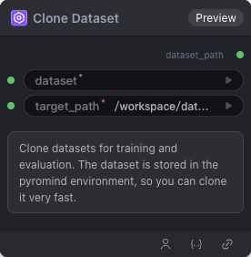

# Clone Dataset Node

  

## 1.1 Overview

Clone a dataset.

## 1.2 Input

| Parameter | Data Type | Required | Description |
|-----------|-----------|----------|-------------|
| dataset | STRING | Yes | Identifier of the official pre-cached dataset to clone, in `org/dataset` format (e.g. `openai/gsm8k`). Must be selected from the platform-supported preset list. Available options: OpenGVLab/ScaleCUA-Data, Writer/omniact, agibot-world/AgiBotWorld-Alpha-327, agibot-world/AgiBotWorld-Alpha-327-Extract, agibot-world/AgiBotWorld-Alpha-CtrlWorld-327, agibot-world/AgiBotWorld-Alpha-Lerobot-327, agibot-world/AgiBotWorld-Alpha-Openpi-327, cadene/droid_1.0.1, gui-360/gui-excel, gui-360/processed_data, henryhe0123/PC-Agent-E, openai/gsm8k, ritzzai/GUI-R1, xlangai/aguvis-stage1, xlangai/aguvis-stage2, zonghanHZH/UGround-V1-8k |
| target_path | STRING | Yes | Destination directory for the cloned dataset. Default: `/workspace/datasets/` Options: /workspace/datasets/ |
## 1.3 Output

| Parameter | Data Type | Description |
|-----------|-----------|-------------|
| dataset_path | STRING | Local path to the cloned dataset |

## 1.4 Workflow JSON Definition

See [`workflow/CloneAndCacheDataset/CloneAndCacheDataset.json`](../../workflow/CloneAndCacheDataset/CloneAndCacheDataset.json) for the full workflow definition.

## 1.5 Running the Workflow

```bash
export PYROMIND_API_KEY=<your-api-key>
python -m pyromind_sdk.test_run_workflow_cli workflow/CloneAndCacheDataset/CloneAndCacheDataset.json [options]
```

| Option | Default | Description |
|--------|---------|-------------|
| `--name` | `cloneAndCacheDataset` | Task name |
| `--output` | - | Output results file |
| `--poll-interval` | 5 | Poll interval in seconds |
| `--timeout` | 600 | Max wait time in seconds |
| `--pretty` | false | Pretty-print JSON output |
| `--max-retries` | 0 | Max retries for API requests |
| `-h, --help` | - | Show help message |

输出示例：

```json
{
  "task_id": "4794",
  "task_name": "cloneandcachedataset",
  "status": "success",
  "error_message": null,
  "nodes": [
    {
      "node_key": "#2",
      "node_id": 18630,
      "node_type": "CloneAndCacheDataset",
      "label": "",
      "start_at": "2026-06-08 09:17:33",
      "end_at": "2026-06-08 09:17:39",
      "duration": "0:00:06",
      "input": {
        "dataset": "openai/gsm8k",
        "target_path": "/workspace/datasets/"
      },
      "output": {
        "dataset_path": "/workspace/datasets/openai/gsm8k"
      },
      "raw": {}
    }
  ]
}
```