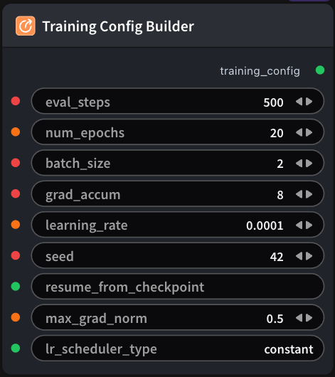

# Training Config Builder Node

  

## 1.1 Overview

Assembles shared SFT/GRPO training hyperparameters into a `training_config` YAML string for downstream training nodes.

- **Hyperparameter Collection**: Accepts optional training parameters such as learning rate, batch size, number of epochs, and gradient accumulation steps
- **Config Generation**: Serializes fields into a YAML string following the `BaseTrainingConfig` schema
- **Downstream Integration**: Outputs `training_config` for `ModelTrainSFTNode` or `ModelTrainGRPONode` (GRPO also requires an additional `grpo_extra_config`)

## 1.2 Input

| Parameter | Data Type | Required | Description |
|-----------|-----------|----------|-------------|
| eval_steps | INT | No | Run validation/evaluation every N training steps. Default: `500` |
| num_epochs | INT | No | Total number of training epochs. Default: `20` |
| batch_size | INT | No | Training batch size per device. Default: `2` |
| grad_accum | INT | No | Gradient accumulation steps; effective batch ≈ batch_size × grad_accum × number of GPUs. Default: `8` |
| learning_rate | FLOAT | No | Optimizer learning rate. Default: `0.0001` |
| seed | INT | No | Random seed for reproducible training. Default: `42` |
| resume_from_checkpoint | STRING | No | Checkpoint path to resume training from; leave empty to train from scratch. Default: - |
| max_grad_norm | FLOAT | No | Maximum gradient norm for gradient clipping, used to stabilize training. Default: `0.5` |
| lr_scheduler_type | STRING | No | Learning rate scheduler type (e.g. `constant`, `cosine`). Default: `constant` |
## 1.3 Output

| Parameter | Data Type | Description |
|-----------|-----------|-------------|
| training_config | STRING | Training config YAML string (`BaseTrainingConfig` fields), passed to the `training_config` input of `ModelTrainSFTNode` or `ModelTrainGRPONode` |

## 1.4 Workflow JSON Definition

See [`workflow/SFTTrainingConfigBuilderNode/SFTTrainingConfigBuilderNode.json`](../../workflow/SFTTrainingConfigBuilderNode/SFTTrainingConfigBuilderNode.json) for the full workflow definition.

## 1.5 Running the Workflow

```bash
export PYROMIND_API_KEY=<your-api-key>
python -m pyromind_sdk.test_run_workflow_cli workflow/SFTTrainingConfigBuilderNode/SFTTrainingConfigBuilderNode.json [options]
```

| Option | Default | Description |
|--------|---------|-------------|
| `--name` | `sFTTrainingConfigBuilderNode` | Task name |
| `--output` | - | Output results file |
| `--poll-interval` | 5 | Poll interval in seconds |
| `--timeout` | 600 | Max wait time in seconds |
| `--pretty` | false | Pretty-print JSON output |
| `--max-retries` | 0 | Max retries for API requests |
| `-h, --help` | - | Show help message |

Example output:

```json
{
  "task_id": "4795",
  "task_name": "sfttrainingconfigbuildernode",
  "status": "success",
  "error_message": null,
  "nodes": [
    {
      "node_key": "#1",
      "node_id": 18631,
      "node_type": "SFTTrainingConfigBuilderNode",
      "label": "",
      "start_at": "2026-06-08 09:20:52",
      "end_at": "2026-06-08 09:21:03",
      "duration": "0:00:11",
      "input": {
        "eval_steps": 500,
        "num_epochs": 20,
        "batch_size": 2,
        "grad_accum": 8,
        "learning_rate": 0.0001,
        "seed": 42,
        "resume_from_checkpoint": "",
        "max_grad_norm": 0.5,
        "lr_scheduler_type": "constant"
      },
      "output": {
        "training_config": "eval_steps: 500\nnum_epochs: 20.0\nbatch_size: 2\ngrad_accum: 8\nlearning_rate: 0.0001\nseed: 42\nmax_grad_norm: 0.5\nlr_scheduler_type: constant"
      },
      "raw": {}
    }
  ]
}
```
