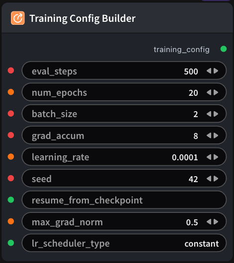

# Training Config Builder 节点

  

## 1.1 功能概述

Build shared training_config YAML (BaseTrainingConfig fields) for SFT and GRPO training_config inputs.

## 1.2 输入类型

| 参数 | 数据类型 | 必填 | 描述 |
|------|---------|------|------|
| eval_steps | INT | 否 | 每隔多少训练步执行一次验证/评估。默认值：`500` |
| num_epochs | INT | 否 | 训练总轮数（epoch）。默认值：`20` |
| batch_size | INT | 否 | 每个设备上的训练 batch 大小。默认值：`2` |
| grad_accum | INT | 否 | 梯度累积步数；有效 batch ≈ batch_size × grad_accum × GPU 数。默认值：`8` |
| learning_rate | FLOAT | 否 | 优化器学习率。默认值：`0.0001` |
| seed | INT | 否 | 整数。默认值：`42` |
| resume_from_checkpoint | STRING | 否 | 字符串。默认值：- |
| max_grad_norm | FLOAT | 否 | 浮点数。默认值：`0.5` |
| lr_scheduler_type | STRING | 否 | 字符串。默认值：`constant` |
## 1.3 输出类型

| 参数 | 数据类型 | 描述 |
|------|---------|------|
| training_config | STRING | 字符串 |

## 1.4 Workflow JSON 定义

完整 workflow 定义见 [`workflow/SFTTrainingConfigBuilderNode/SFTTrainingConfigBuilderNode.json`](../../workflow/SFTTrainingConfigBuilderNode/SFTTrainingConfigBuilderNode.json)。

## 1.5 运行 Workflow

```bash
export PYROMIND_API_KEY=<your-api-key>
python -m pyromind_sdk.test_run_workflow_cli workflow/SFTTrainingConfigBuilderNode/SFTTrainingConfigBuilderNode.json [options]
```

| 选项 | 默认值 | 说明 |
|------|--------|------|
| `--name` | `sFTTrainingConfigBuilderNode` | 任务名称 |
| `--output` | - | 输出结果文件 |
| `--poll-interval` | 5 | 轮询间隔（秒） |
| `--timeout` | 600 | 最大等待时间（秒） |
| `--pretty` | false | 美化 JSON 输出 |
| `--max-retries` | 0 | API 请求最大重试次数 |
| `-h, --help` | - | 显示帮助信息 |
