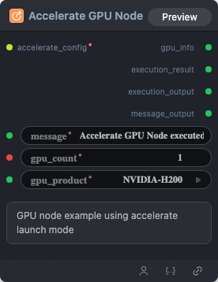

# Accelerate GPU Node Node



## 1.1 Overview

GPU node example using accelerate launch mode

## 1.2 Input

| Parameter | Data Type | Required | Description |
|-----------|-----------|----------|-------------|
| message | STRING | Yes | Default: `Accelerate GPU Node executed successfully` |

## 1.3 Output

| Parameter | Data Type | Description |
|-----------|-----------|-------------|
| gpu_info | STRING | gpu_info |
| execution_result | STRING | execution_result |
| execution_output | STRING | execution_output |
| message_output | STRING | message_output |

## 1.4 Workflow JSON Definition

See [`workflow/AccelerateGpuNode/AccelerateGpuNode.json`](../../workflow/AccelerateGpuNode/AccelerateGpuNode.json) for the full workflow definition.

## 1.5 Running the Workflow

```bash
export PYROMIND_API_KEY=<your-api-key>
python -m pyromind_sdk.test_run_workflow_cli workflow/AccelerateGpuNode/AccelerateGpuNode.json --pretty
```

| Option | Default | Description |
|--------|---------|-------------|
| `--name` | `accelerateGpuNode` | Task name |
| `--output` | - | Output results file |
| `--poll-interval` | 5 | Poll interval in seconds |
| `--timeout` | 600 | Max wait time in seconds |
| `--pretty` | false | Pretty-print JSON output |
| `--max-retries` | 0 | Max retries for API requests |
| `-h, --help` | - | Show help message |


```bash
python -m pyromind_sdk.test_run_workflow_cli workflow/AccelerateGpuNode/AccelerateGpuNode.json --pretty
```

Example output:

```json
{
  "task_id": "5045",
  "task_name": "accelerategpunode",
  "status": "success",
  "error_message": null,
  "nodes": [
    {
      "node_key": "#1",
      "node_id": 19379,
      "node_type": "AccelerateGpuNode",
      "label": "",
      "start_at": "2026-06-11 02:08:03",
      "end_at": "2026-06-11 02:08:33",
      "duration": "0:00:30",
      "input": {
        "message": "Accelerate GPU Node executed successfully",
        "accelerate_config": "",
        "gpu_count": 1,
        "gpu_product": "NVIDIA-H100-NVL"
      },
      "output": {
        "gpu_info": "NVIDIA H100 NVL",
        "execution_result": "Code executed successfully",
        "execution_output": "Accelerate GPU Node executed successfullyCUDA available: True\nGPU count: 1\nGPU name: NVIDIA H100 NVL",
        "message_output": "Accelerate GPU Node executed successfullyCUDA available: True\nGPU count: 1\nGPU name: NVIDIA H100 NVL"
      },
      "raw": {}
    },
    {
      "node_key": "#2",
      "node_id": 19378,
      "node_type": "AccelerateConfigBuilderNode",
      "label": "",
      "start_at": "2026-06-11 02:07:38",
      "end_at": "2026-06-11 02:07:55",
      "duration": "0:00:17",
      "input": {
        "zero_stage": 2,
        "gpu_count": 4
      },
      "output": {
        "accelerate_config": "compute_environment: LOCAL_MACHINE\ndebug: false\ndeepspeed_config:\n  zero3_init_flag: false\n  zero_stage: 2\ndistributed_type: DEEPSPEED\nenable_cpu_affinity: true\nmachine_rank: 0\nmain_training_function: main\nnum_machines: 1\nnum_processes: 4\nrdzv_backend: static\nsame_network: true\nmixed_precision: bf16"
      },
      "raw": {}
    }
  ]
}
