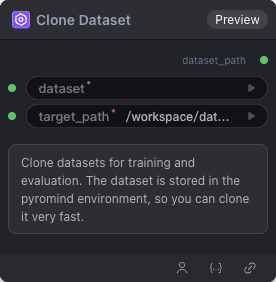

# Clone Dataset Node

  

## {{section}} Overview

克隆数据集

## {{section}} Input

| Parameter | Data Type | Required | Description |
|-----------|-----------|----------|-------------|
| dataset | STRING | Yes | String value. Default: - Options: OpenGVLab/ScaleCUA-Data, Writer/omniact, agibot-world/AgiBotWorld-Alpha-327, agibot-world/AgiBotWorld-Alpha-327-Extract, agibot-world/AgiBotWorld-Alpha-CtrlWorld-327, agibot-world/AgiBotWorld-Alpha-Lerobot-327, agibot-world/AgiBotWorld-Alpha-Openpi-327, cadene/droid_1.0.1, gui-360/gui-excel, gui-360/processed_data, henryhe0123/PC-Agent-E, openai/gsm8k, ritzzai/GUI-R1, xlangai/aguvis-stage1, xlangai/aguvis-stage2, zonghanHZH/UGround-V1-8k |
| target_path | STRING | Yes | String value. Default: `/workspace/datasets/` Options: /workspace/datasets/ |
## {{section}} Output

| Parameter | Data Type | Description |
|-----------|-----------|-------------|
| dataset_path | STRING | String value |

## {{section}} Workflow JSON Definition

See [`workflow/CloneAndCacheDataset/CloneAndCacheDataset.json`](../../workflow/CloneAndCacheDataset/CloneAndCacheDataset.json) for the full workflow definition.

## {{section}} Running the Workflow

```bash
export PYROMIND_API_KEY=<your-api-key>
python -m pyromind_sdk.test_run_workflow_cli workflow/CloneAndCacheDataset/CloneAndCacheDataset.json [options]
```

| Option | Default | Description |
|--------|---------|-------------|
| `--name` | `cloneAndCacheDataset` | Task name |
| `--output` | - | Output results file |
| `--poll-interval` | 5 | Poll interval in seconds |
| `--timeout` | 600 | Max wait time in seconds |
| `--pretty` | false | Pretty-print JSON output |
| `--max-retries` | 0 | Max retries for API requests |
| `-h, --help` | - | Show help message |
