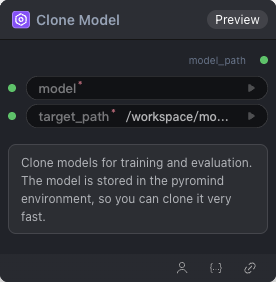

# Clone Model Node

  

## 1.1 Overview

克隆模型

## 1.2 Input

| Parameter | Data Type | Required | Description |
|-----------|-----------|----------|-------------|
| model | STRING | Yes | String value. Default: - Options: Qwen/Qwen3-0.6B, Qwen/Qwen3-1.7B, Qwen/Qwen3-14B, Qwen/Qwen3-235B-A22B-FP8, Qwen/Qwen3-32B, Qwen/Qwen3-32B-FP8, Qwen/Qwen3-4B, Qwen/Qwen3-8B, Qwen/Qwen3-VL-235B-A22B-Instruct, Qwen/Qwen3-VL-32B-Instruct, Qwen/Qwen3-VL-4B-Instruct, openai/clip-vit-base-patch32, openpi/big_vision, openpi/pi05_base, pretrained/gui-ck900-lora, stabilityai/stable-video-diffusion-img2vid |
| target_path | STRING | Yes | String value. Default: `/workspace/models/` Options: /workspace/models/ |
## 1.3 Output

| Parameter | Data Type | Description |
|-----------|-----------|-------------|
| model_path | MODEL | Model reference |

## 1.4 Workflow JSON Definition

See [`workflow/CloneAndCacheModel/CloneAndCacheModel.json`](../../workflow/CloneAndCacheModel/CloneAndCacheModel.json) for the full workflow definition.

## 1.5 Running the Workflow

```bash
export PYROMIND_API_KEY=<your-api-key>
python -m pyromind_sdk.test_run_workflow_cli workflow/CloneAndCacheModel/CloneAndCacheModel.json [options]
```

| Option | Default | Description |
|--------|---------|-------------|
| `--name` | `cloneAndCacheModel` | Task name |
| `--output` | - | Output results file |
| `--poll-interval` | 5 | Poll interval in seconds |
| `--timeout` | 600 | Max wait time in seconds |
| `--pretty` | false | Pretty-print JSON output |
| `--max-retries` | 0 | Max retries for API requests |
| `-h, --help` | - | Show help message |
