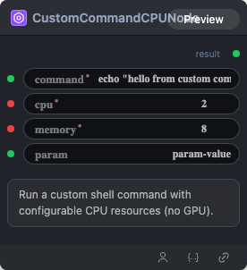

# Custom Command CPU Node

## 1.1 Overview

Run a custom shell command with configurable CPU and memory resources (no GPU). Command output is captured and returned as a string.

## 1.2 Input

| Parameter | Data Type | Required | Description |
|-----------|-----------|----------|-------------|
| command | STRING | Yes | Shell command to execute. Default: echo hello from custom command |
| cpu | INT | Yes | CPU limit in cores (1–64). Default: 4 |
| memory | INT | Yes | Memory limit in GiB (1–256). Default: 32 |
| param | STRING | No | Optional parameter passed to the shell command and referenced as `$param`. Default: param-value |

## 1.3 Output

| Parameter | Data Type | Description |
|-----------|-----------|-------------|
| result | STRING | Captured standard output and standard error from the command. |

## 1.4 Workflow JSON Definition

See [workflow/CustomCommandCPUNode/CustomCommandCPUNode.json](../../workflow/CustomCommandCPUNode/CustomCommandCPUNode.json) for a sanitized single-node workflow example.

## 1.5 Running the Workflow

~~~bash
export PYROMIND_API_KEY=<your-api-key>
python -m pyromind_sdk.test_run_workflow_cli workflow/CustomCommandCPUNode/CustomCommandCPUNode.json --pretty
~~~
