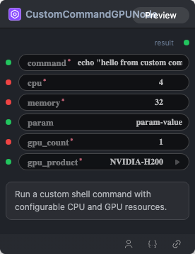

# Custom Command Node

## 1.1 Overview

Run a custom shell command with configurable CPU, memory, and GPU resources. Command output is captured and returned as a string.

## 1.2 Input

| Parameter | Data Type | Required | Description |
|-----------|-----------|----------|-------------|
| command | STRING | Yes | Shell command to execute. Default: echo hello from custom command |
| cpu | INT | Yes | CPU limit in cores (1–64). Default: 4 |
| memory | INT | Yes | Memory limit in GiB (1–256). Default: 32 |
| gpu_count | INT | Yes | Number of GPUs to request (1–8). Default: 1 |
| gpu_product | STRING | Yes | GPU product to request when gpu_count is greater than zero. Options: NVIDIA-H200, NVIDIA-H100-80GB-HBM3. (subject to actual GPUs available in the target environment) |
| param | STRING | No | Optional parameter passed to the shell command and referenced as `$param`. Default: param-value |

## 1.3 Output

| Parameter | Data Type | Description |
|-----------|-----------|-------------|
| result | STRING | Captured standard output and standard error from the command. |

## 1.4 Workflow JSON Definition

See [workflow/CustomCommandNode/CustomCommandNode.json](../../workflow/CustomCommandNode/CustomCommandNode.json) for a sanitized single-node workflow example.

## 1.5 Running the Workflow

~~~bash
export PYROMIND_API_KEY=<your-api-key>
python -m pyromind_sdk.test_run_workflow_cli workflow/CustomCommandNode/CustomCommandNode.json --pretty
~~~
