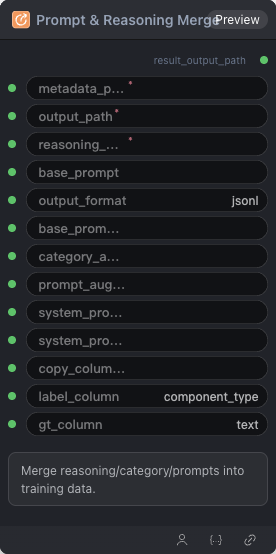

# Prompt & Reasoning Merge Node

  

## 1.1 Overview

Merge reasoning/category/prompts into training data.

## 1.2 Input

| Parameter | Data Type | Required | Description |
|-----------|-----------|----------|-------------|
| metadata_path | STRING | Yes | String value. Default: - |
| output_path | STRING | Yes | String value. Default: - |
| reasoning_path | STRING | Yes | String value. Default: - |
| base_prompt | STRING | No | String value. Default: - |
| output_format | STRING | No | String value. Default: `jsonl` |
| base_prompt_file | STRING | No | String value. Default: - |
| category_annotations | STRING | No | String value. Default: - |
| prompt_augmentation_path | STRING | No | String value. Default: - |
| system_prompt | STRING | No | String value. Default: - |
| system_prompt_file | STRING | No | String value. Default: - |
| copy_columns | STRING | No | String value. Default: - |
| label_column | STRING | No | String value. Default: `component_type` |
| gt_column | STRING | No | String value. Default: `text` |
## 1.3 Output

| Parameter | Data Type | Description |
|-----------|-----------|-------------|
| result_output_path | STRING | String value |

## 1.4 Workflow JSON Definition

See [`workflow/DataPreprocessMergeNode/DataPreprocessMergeNode.json`](../../workflow/DataPreprocessMergeNode/DataPreprocessMergeNode.json) for the full workflow definition.

## 1.5 Running the Workflow

```bash
export PYROMIND_API_KEY=<your-api-key>
python -m pyromind_sdk.test_run_workflow_cli workflow/DataPreprocessMergeNode/DataPreprocessMergeNode.json [options]
```

| Option | Default | Description |
|--------|---------|-------------|
| `--name` | `dataPreprocessMergeNode` | Task name |
| `--output` | - | Output results file |
| `--poll-interval` | 5 | Poll interval in seconds |
| `--timeout` | 600 | Max wait time in seconds |
| `--pretty` | false | Pretty-print JSON output |
| `--max-retries` | 0 | Max retries for API requests |
| `-h, --help` | - | Show help message |
