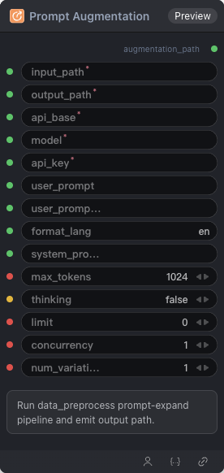

# Prompt Augmentation Node

  

## {{section}} Overview

Run data_preprocess prompt-expand pipeline and emit output path.

## {{section}} Input

| Parameter | Data Type | Required | Description |
|-----------|-----------|----------|-------------|
| input_path | STRING | Yes | String value. Default: - |
| output_path | STRING | Yes | String value. Default: - |
| api_base | STRING | Yes | String value. Default: - |
| model | STRING | Yes | String value. Default: - |
| api_key | STRING | Yes | String value. Default: - |
| user_prompt | STRING | No | String value. Default: - |
| user_prompt_column | STRING | No | String value. Default: - |
| format_lang | STRING | No | String value. Default: `en` |
| system_prompt | STRING | No | String value. Default: - |
| max_tokens | INT | No | Integer value. Default: `1024` |
| thinking | BOOLEAN | No | Boolean flag (true/false). Default: `False` |
| limit | INT | No | Integer value. Default: `0` |
| concurrency | INT | No | Integer value. Default: `1` |
| num_variations | INT | No | Integer value. Default: `1` |
## {{section}} Output

| Parameter | Data Type | Description |
|-----------|-----------|-------------|
| augmentation_path | STRING | String value |

## {{section}} Workflow JSON Definition

See [`workflow/DataPreprocessPromptExpandNode/DataPreprocessPromptExpandNode.json`](../../workflow/DataPreprocessPromptExpandNode/DataPreprocessPromptExpandNode.json) for the full workflow definition.

## {{section}} Running the Workflow

```bash
export PYROMIND_API_KEY=<your-api-key>
python -m pyromind_sdk.test_run_workflow_cli workflow/DataPreprocessPromptExpandNode/DataPreprocessPromptExpandNode.json [options]
```

| Option | Default | Description |
|--------|---------|-------------|
| `--name` | `dataPreprocessPromptExpandNode` | Task name |
| `--output` | - | Output results file |
| `--poll-interval` | 5 | Poll interval in seconds |
| `--timeout` | 600 | Max wait time in seconds |
| `--pretty` | false | Pretty-print JSON output |
| `--max-retries` | 0 | Max retries for API requests |
| `-h, --help` | - | Show help message |
