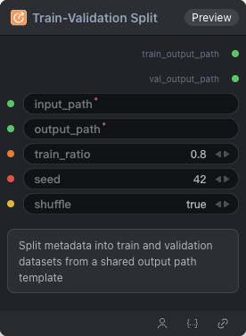

# Train-Validation Split Node



## 1.1 Overview

Split metadata into train and validation datasets from a shared output path template

## 1.2 Input

| Parameter | Data Type | Required | Description |
|-----------|-----------|----------|-------------|
| input_path | STRING | Yes | Input path |
| output_path | STRING | Yes | Output directory or file path |
| train_ratio | FLOAT | No | Train ratio. Default: `0.8` |
| seed | INT | No | Random seed. Default: `42` |
| shuffle | BOOLEAN | No | Shuffle. Default: true |

## 1.3 Output

| Parameter | Data Type | Description |
|-----------|-----------|-------------|
| train_output_path | STRING | Train split output path |
| val_output_path | STRING | Validation split output path |

## 1.4 Workflow JSON Definition

See [`workflow/DataPreprocessSplitNode/DataPreprocessSplitNode.json`](../../workflow/DataPreprocessSplitNode/DataPreprocessSplitNode.json) for the full workflow definition.

## 1.5 Running the Workflow

```bash
export PYROMIND_API_KEY=<your-api-key>
python -m pyromind_sdk.test_run_workflow_cli workflow/DataPreprocessSplitNode/DataPreprocessSplitNode.json [options]
```

| Option | Default | Description |
|--------|---------|-------------|
| `--name` | `dataPreprocessSplitNode` | Task name |
| `--output` | - | Output results file |
| `--poll-interval` | 5 | Poll interval in seconds |
| `--timeout` | 600 | Max wait time in seconds |
| `--pretty` | false | Pretty-print JSON output |
| `--max-retries` | 0 | Max retries for API requests |
| `-h, --help` | - | Show help message |
