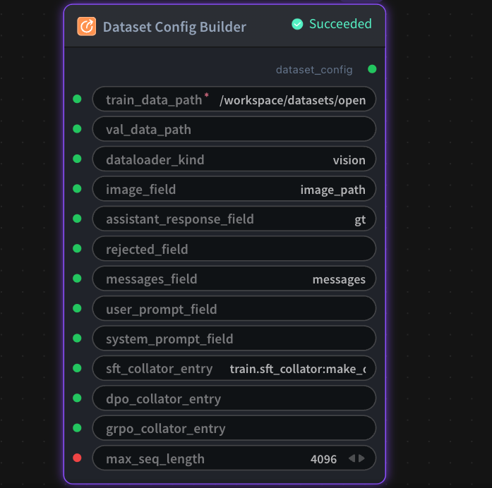

# Dataset Config Builder Node



## 1.1 Overview

Builds a dataset configuration YAML string for SFT/GRPO training. This node is used to configure training data paths, dataloader type, field mappings, and other parameters.

## 1.2 Input

| Parameter | Data Type | Required | Description |
|-----------|-----------|----------|-------------|
| train_data_path | STRING | Yes | Training data path |
| val_data_path | STRING | No | Validation data path. Default: empty string |
| dataloader_kind | STRING | No | Dataloader type. Default: `vision` |
| image_field | STRING | No | Image field name. Default: `image_path` |
| assistant_response_field | STRING | No | Assistant response field name. Default: `gt` |
| rejected_field | STRING | No | Rejected response field name (for DPO). Default: empty string |
| messages_field | STRING | No | Messages field name. Default: `messages` |
| user_prompt_field | STRING | No | User prompt field name. Default: empty string |
| system_prompt_field | STRING | No | System prompt field name. Default: empty string |
| sft_collator_entry | STRING | No | SFT collator entry. Default: `train.sft_collator:make_collate_fn` |
| dpo_collator_entry | STRING | No | DPO collator entry. Default: empty string |
| grpo_collator_entry | STRING | No | GRPO collator entry. Default: empty string |
| max_seq_length | INT | No | Maximum sequence length. Default: `4096` |

## 1.3 Output

| Parameter | Data Type | Description |
|-----------|-----------|-------------|
| dataset_config | STRING | Built dataset configuration YAML string |

## 1.4 Workflow JSON Definition

See [`DatasetConfigBuilderNode.json`](../../workflow/DatasetConfigBuilderNode/DatasetConfigBuilderNode.json) for the full workflow definition.

Example configuration:
```json
{
  "config": {
    "train_data_path": "/workspace/datasets/openai/gsm8k/",
    "val_data_path": "",
    "dataloader_kind": "vision",
    "image_field": "image_path",
    "assistant_response_field": "gt",
    "rejected_field": "",
    "messages_field": "messages",
    "user_prompt_field": "",
    "system_prompt_field": "",
    "sft_collator_entry": "train.sft_collator:make_collate_fn",
    "dpo_collator_entry": "",
    "grpo_collator_entry": "",
    "max_seq_length": 4096
  }
}
```

## 1.5 Running the Workflow

```bash
export PYROMIND_API_KEY=<your-api-key>
python -m pyromind_sdk.test_run_workflow_cli workflow/DatasetConfigBuilderNode/DatasetConfigBuilderNode.json [options]
```

| Option | Default | Description |
|--------|---------|-------------|
| `--name` | `DatasetConfigBuilderNode` | Task name |
| `--output` | - | Output results file |
| `--poll-interval` | 5 | Poll interval in seconds |
| `--timeout` | 600 | Max wait time in seconds |
| `--pretty` | false | Pretty-print JSON output |
| `--max-retries` | 0 | Max retries for API requests |
| `-h, --help` | - | Show help message |

```bash
python -m pyromind_sdk.test_run_workflow_cli workflow/DatasetConfigBuilderNode/DatasetConfigBuilderNode.json --pretty
```

Example output:

```json
{
  "task_id": "4923",
  "task_name": "test-traindata",
  "status": "success",
  "error_message": null,
  "nodes": [
    {
      "node_key": "#1",
      "node_id": 18989,
      "node_type": "DatasetConfigBuilderNode",
      "label": "",
      "start_at": "2026-06-09 09:49:32",
      "end_at": "2026-06-09 09:49:39",
      "duration": "0:00:07",
      "input": {
        "train_data_path": "/workspace/datasets/openai/gsm8k/",
        "val_data_path": "",
        "dataloader_kind": "vision",
        "image_field": "image_path",
        "assistant_response_field": "gt",
        "rejected_field": "",
        "messages_field": "messages",
        "user_prompt_field": "",
        "system_prompt_field": "",
        "sft_collator_entry": "train.sft_collator:make_collate_fn",
        "dpo_collator_entry": "",
        "grpo_collator_entry": "",
        "max_seq_length": 4096
      },
      "output": {
        "dataset_config": "train_data_path: /workspace/datasets/openai/gsm8k/\ndataloader_kind: vision\nimage_field: image_path\nassistant_response_field: gt\nrejected_field: ''\nmessages_field: messages\nsft_collator_entry: train.sft_collator:make_collate_fn\ndpo_collator_entry: ''\ngrpo_collator_entry: ''\nmax_seq_length: 4096"
      },
      "raw": {}
    }
  ]
}
```
