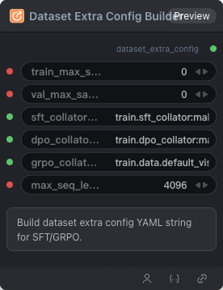

# Dataset Extra Config Builder Node



## 1.1 Overview

Builds the `dataset_extra_config` YAML fragment (collator entries, max samples, max sequence length). Connect its output to `DatasetConfigBuilderNode.dataset_extra_config`.

## 1.2 Input

| Parameter | Data Type | Required | Description |
|-----------|-----------|----------|-------------|
| train_max_samples | INT | No | Max training samples (0 = all). Default: `0` |
| val_max_samples | INT | No | Max validation samples (0 = all). Default: `0` |
| sft_collator_entry | STRING | No | SFT collator entry (`module:function`). Default: `train.sft_collator:make_collate_fn` |
| dpo_collator_entry | STRING | No | DPO collator entry (`module:function`). Default: `train.dpo_collator:make_collate_fn` |
| grpo_collator_entry | STRING | No | GRPO collator entry (`module:function`). Default: `train.data.default_vision_grpo_collate:create_grpo_collate_fn` |
| max_seq_length | INT | No | Maximum sequence length. Default: `4096` |
## 1.3 Output

| Parameter | Data Type | Description |
|-----------|-----------|-------------|
| dataset_extra_config | STRING\|DATASET_EXTRA_CONFIG | Dataset extra config YAML from Dataset Extra Config Builder |
## 1.4 Workflow JSON Definition

See [`workflow/DatasetExtraConfigBuilderNode/DatasetExtraConfigBuilderNode.json`](../../workflow/DatasetExtraConfigBuilderNode/DatasetExtraConfigBuilderNode.json) for the full workflow definition.

## 1.5 Running the Workflow

```bash
export PYROMIND_API_KEY=<your-api-key>
python -m pyromind_sdk.test_run_workflow_cli workflow/DatasetExtraConfigBuilderNode/DatasetExtraConfigBuilderNode.json [options]
```

| Option | Default | Description |
|--------|---------|-------------|
| `--name` | `datasetExtraConfigBuilderNode` | Task name |
| `--output` | - | Output results file |
| `--poll-interval` | 5 | Poll interval in seconds |
| `--timeout` | 600 | Max wait time in seconds |
| `--pretty` | false | Pretty-print JSON output |
| `--max-retries` | 0 | Max retries for API requests |
| `-h, --help` | - | Show help message |
