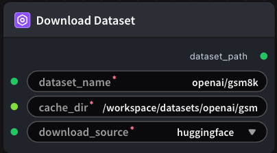

# Download Dataset Node

  

## 1.1 Overview

Downloads a specified dataset from a remote repository, caches it locally, and outputs the dataset path for downstream nodes.

- **Download source**: supports `huggingface` and `modelscope`
- **Local cache**: downloads the dataset to the directory specified by `cache_dir`; creates the directory if it does not exist
- **Path output**: returns `dataset_path` for LoadDataset, data preprocessing, or training nodes

## 1.2 Input

| Parameter | Data Type | Required | Description |
|-----------|-----------|----------|-------------|
| dataset_name | STRING | Yes | Dataset name or repository ID. Default: `openai/gsm8k`. Example: `openai/gsm8k` |
| cache_dir | PATH | Yes | Local cache directory. Default: `/workspace/datasets/openai/gsm8k` |
| download_source | STRING | Yes | Download source. Default: `huggingface`. Options: `huggingface`, `modelscope` |

## 1.3 Output

| Parameter | Data Type | Description |
|-----------|-----------|-------------|
| dataset_path | STRING | Local path of the downloaded dataset. For example, with `cache_dir=/workspace/datasets/openai/gsm8k`, outputs `/workspace/datasets/openai/gsm8k` |

## 1.4 Workflow JSON Definition

See [`workflow/DownloadAndCacheDataset/DownloadAndCacheDataset.json`](../../workflow/DownloadAndCacheDataset/DownloadAndCacheDataset.json) for the full workflow definition.

Example node configuration:

```json
{
  "dataset_name": "openai/gsm8k",
  "cache_dir": "/workspace/datasets/openai/gsm8k",
  "download_source": "huggingface"
}
```

## 1.5 Running the Workflow

```bash
export PYROMIND_API_KEY=<your-api-key>
python -m pyromind_sdk.test_run_workflow_cli workflow/DownloadAndCacheDataset/DownloadAndCacheDataset.json [options]
```

| Option | Default | Description |
|--------|---------|-------------|
| `--name` | `downloadAndCacheDataset` | Task name |
| `--output` | - | Output results file |
| `--poll-interval` | 5 | Poll interval in seconds |
| `--timeout` | 600 | Max wait time in seconds |
| `--pretty` | false | Pretty-print JSON output |
| `--max-retries` | 0 | Max retries for API requests |
| `-h, --help` | - | Show help message |

```bash
python -m pyromind_sdk.test_run_workflow_cli workflow/DownloadAndCacheDataset/DownloadAndCacheDataset.json --pretty
```

Example output:

```json
{
  "task_name": "unsaved-workflow",
  "status": "success",
  "nodes": [
    {
      "node_type": "DownloadAndCacheDataset",
      "label": "Download Dataset",
      "input": {
        "dataset_name": "openai/gsm8k",
        "cache_dir": "/workspace/datasets/openai/gsm8k",
        "download_source": "huggingface"
      },
      "output": {
        "dataset_path": "/workspace/datasets/openai/gsm8k"
      }
    }
  ]
}
```
