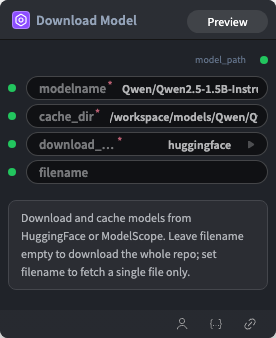

# Download Model Node

  

## 1.1 Overview

下载并缓存数据集

## 1.2 Input

| Parameter | Data Type | Required | Description |
|-----------|-----------|----------|-------------|
| modelname | STRING | Yes | String value. Default: `Qwen/Qwen2.5-1.5B-Instruct` |
| cache_dir | STRING | Yes | String value. Default: `/workspace/models/Qwen/Qwen2.5-1.5B-Instruct` |
| download_source | STRING | Yes | String value. Default: `huggingface` Options: huggingface, modelscope |
## 1.3 Output

| Parameter | Data Type | Description |
|-----------|-----------|-------------|
| model_path | MODEL | Model reference |

## 1.4 Workflow JSON Definition

See [`workflow/DownloadAndCacheModel/DownloadAndCacheModel.json`](../../workflow/DownloadAndCacheModel/DownloadAndCacheModel.json) for the full workflow definition.

## 1.5 Running the Workflow

```bash
export PYROMIND_API_KEY=<your-api-key>
python -m pyromind_sdk.test_run_workflow_cli workflow/DownloadAndCacheModel/DownloadAndCacheModel.json [options]
```

| Option | Default | Description |
|--------|---------|-------------|
| `--name` | `downloadAndCacheModel` | Task name |
| `--output` | - | Output results file |
| `--poll-interval` | 5 | Poll interval in seconds |
| `--timeout` | 600 | Max wait time in seconds |
| `--pretty` | false | Pretty-print JSON output |
| `--max-retries` | 0 | Max retries for API requests |
| `-h, --help` | - | Show help message |
