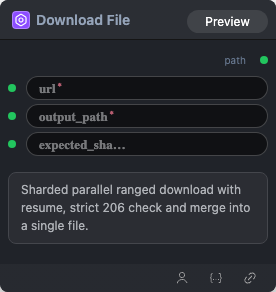

# Download File Node



## 1.1 Overview

Downloads a file from a URL into a local workspace path. The node uses sharded, parallel ranged downloads with resume support, verifies HTTP 206 partial content responses, and merges the parts into a single output file.

## 1.2 Input

| Parameter | Data Type | Required | Description |
|-----------|-----------|----------|-------------|
| url | STRING | Yes | Remote file URL to download. |
| output_path | STRING | Yes | Local path where the merged file is written. |
| expected_sha256 | STRING | No | Optional expected SHA-256 checksum. When set, the downloaded file is verified against it. |

## 1.3 Output

| Parameter | Data Type | Description |
|-----------|-----------|-------------|
| path | STRING | Local path of the downloaded file. |

## 1.4 Workflow JSON Definition

See [workflow/DownloadURLNode/DownloadURLNode.json](../../workflow/DownloadURLNode/DownloadURLNode.json) for a single-node workflow example.

Example node configuration:

```json
{
  "url": "https://huggingface.co/Qwen/Qwen2.5-1.5B-Instruct/resolve/main/config.json",
  "output_path": "/workspace/downloads/config.json",
  "expected_sha256": ""
}
```

## 1.5 Running the Workflow

```bash
export PYROMIND_API_KEY=<your-api-key>
python -m pyromind_sdk.test_run_workflow_cli workflow/DownloadURLNode/DownloadURLNode.json [options]
```

| Option | Default | Description |
|--------|---------|-------------|
| `--name` | `DownloadURLNode example` | Task name |
| `--output` | - | Output results file |
| `--poll-interval` | 5 | Poll interval in seconds |
| `--timeout` | 600 | Max wait time in seconds |
| `--pretty` | false | Pretty-print JSON output |
| `--max-retries` | 0 | Max retries for API requests |
| `-h, --help` | - | Show help message |

```bash
python -m pyromind_sdk.test_run_workflow_cli workflow/DownloadURLNode/DownloadURLNode.json --pretty
```
