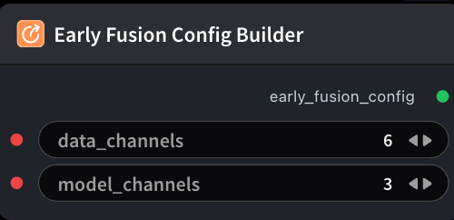

# Early Fusion Config Builder



## 1.1 Overview

Builds early-fusion config YAML (`data_channels = 3 × num_views`) for **YOLO Training**. Example: 2 views → 6, 3 views → 9. Connect to `ModelTrainYoloNode.early_fusion_config`; omit for single-view 3ch.

## 1.2 Input

| Parameter | Data Type | Required | Description |
|-----------|-----------|----------|-------------|
| data_channels | INT | No | Stacked input channels (`3 × num_views`, e.g. 6 for two RGB views). Default: `6` |
| model_channels | INT | No | Channels after early fusion into the YOLO backbone (usually 3). Default: `3` |

## 1.3 Output

| Parameter | Data Type | Description |
|-----------|-----------|-------------|
| early_fusion_config | STRING | Early-fusion config YAML |

## 1.4 Workflow JSON Definition

See [`workflow/EarlyFusionConfigBuilderNode/EarlyFusionConfigBuilderNode.json`](../../workflow/EarlyFusionConfigBuilderNode/EarlyFusionConfigBuilderNode.json) for the full workflow definition.

## 1.5 Running the Workflow

```bash
export PYROMIND_API_KEY=<your-api-key>
python -m pyromind_sdk.test_run_workflow_cli workflow/EarlyFusionConfigBuilderNode/EarlyFusionConfigBuilderNode.json [options]
```

| Option | Default | Description |
|--------|---------|-------------|
| `--name` | `earlyFusionConfigBuilderNode` | Task name |
| `--output` | - | Output results file |
| `--poll-interval` | 5 | Poll interval in seconds |
| `--timeout` | 600 | Max wait time in seconds |
| `--pretty` | false | Pretty-print JSON output |
| `--max-retries` | 0 | Max retries for API requests |
| `-h, --help` | - | Show help message |
