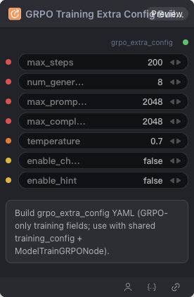

# GRPO Training Extra Config Builder Node



## 1.1 Overview

Build grpo_extra_config YAML (GRPO-only training fields; use with shared training_config + ModelTrainGRPONode).

## 1.2 Input

| Parameter | Data Type | Required | Description |
|-----------|-----------|----------|-------------|
| max_steps | INT | No | Maximum training steps (GRPO extra). Default: `200` |
| num_generations | INT | No | Generations per prompt (GRPO extra). Default: `8` |
| max_prompt_length | INT | No | Maximum prompt length (GRPO extra). Default: `2048` |
| max_completion_length | INT | No | Maximum completion length (GRPO extra). Default: `2048` |
| temperature | FLOAT | No | Sampling temperature. Default: `0.7` |
| enable_chord | BOOLEAN | No | Enable CHORD algorithm (GRPO extra). Default: false |
| enable_hint | BOOLEAN | No | Enable hint mode (GRPO extra). Default: false |

## 1.3 Output

| Parameter | Data Type | Description |
|-----------|-----------|-------------|
| grpo_extra_config | STRING | GRPO-only extra training config YAML |

## 1.4 Workflow JSON Definition

See [`workflow/GRPOTrainingExtraConfigBuilderNode/GRPOTrainingExtraConfigBuilderNode.json`](../../workflow/GRPOTrainingExtraConfigBuilderNode/GRPOTrainingExtraConfigBuilderNode.json) for the full workflow definition.

## 1.5 Running the Workflow

```bash
export PYROMIND_API_KEY=<your-api-key>
python -m pyromind_sdk.test_run_workflow_cli workflow/GRPOTrainingExtraConfigBuilderNode/GRPOTrainingExtraConfigBuilderNode.json [options]
```

| Option | Default | Description |
|--------|---------|-------------|
| `--name` | `gRPOTrainingExtraConfigBuilderNode` | Task name |
| `--output` | - | Output results file |
| `--poll-interval` | 5 | Poll interval in seconds |
| `--timeout` | 600 | Max wait time in seconds |
| `--pretty` | false | Pretty-print JSON output |
| `--max-retries` | 0 | Max retries for API requests |
| `-h, --help` | - | Show help message |
