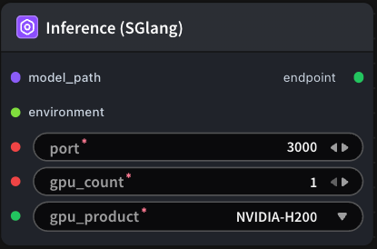

# Inference (SGlang) Node



## 1.1 Overview

Based on the provided parameters, this node starts an inference service that continuously serves subsequent nodes until the workflow completes and the service is terminated.

## 1.2 Input

| Parameter | Data Type | Required | Description |
|-----------|-----------|----------|-------------|
| model_path | STRING | Yes | Model reference. Default: - |
| environment | ENV | No | Environment variable name. Default: - |
| port | INT | Yes | Inference service port number |
| gpu_count | INT | Yes | Number of GPUs used by the inference service |
| gpu_product | STRING | Yes | GPU type. Default: `NVIDIA-H100-NVL` Options: NVIDIA-H100-NVL, NVIDIA-L40S, NVIDIA-H200, NVIDIA-B200, NVIDIA-H100-80GB-HBM3 |


## 1.3 Output

| Parameter | Data Type | Description |
|-----------|-----------|-------------|
| endpoint | STRING | Endpoint of the inference service |

## 1.4 Workflow JSON Definition

See [`workflow/Inference/Inference.json`](../../workflow/Inference/Inference.json) for the full workflow definition.

## 1.5 Running the Workflow

```bash
export PYROMIND_API_KEY=<your-api-key>
export PYROMIND_CLUSTER=<your-cluster>
python -m pyromind_sdk.test_run_workflow_cli workflow/Inference/Inference.json --pretty
```

| Option | Default | Description |
|--------|---------|-------------|
| `--name` | `inference` | Task name |
| `--output` | - | Output results file |
| `--poll-interval` | 5 | Poll interval in seconds |
| `--timeout` | 600 | Max wait time in seconds |
| `--pretty` | false | Pretty-print JSON output |
| `--max-retries` | 0 | Max retries for API requests |
| `-h, --help` | - | Show help message |


Example output:

```json
{
  "task_id": "4805",
  "task_name": "start-inference-sglang",
  "status": "success",
  "error_message": null,
  "nodes": [
    {
      "node_key": "#1",
      "node_id": 18647,
      "node_type": "Inference",
      "label": "Inference (SGlang)",
      "start_at": "2026-06-08 11:05:03",
      "end_at": "2026-06-08 11:05:13",
      "duration": "0:00:10",
      "input": {
        "model_path": "",
        "port": 3000,
        "gpu_count": 1,
        "gpu_product": "NVIDIA-L40S",
        "environment": ""
      },
      "output": null
    },
    {
      "node_key": "#2",
      "node_id": 18646,
      "node_type": "LoadModel",
      "label": "Load Model",
      "start_at": "2026-06-08 11:04:43",
      "end_at": "2026-06-08 11:04:56",
      "duration": "0:00:13",
      "input": {
        "model_path": "/workspace/models/Qwen/Qwen2.5-1.5B-Instruct/"
      },
      "output": {
        "model": "/workspace/models/Qwen/Qwen2.5-1.5B-Instruct/"
      },
      "raw": {}
    }
  ]
}
```