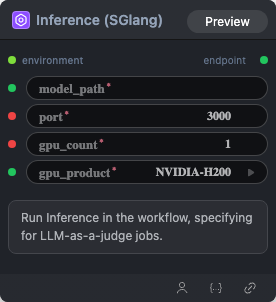

# Inference (SGlang) Node

  

## {{section}} Overview

RL推理配置

## {{section}} Input

| Parameter | Data Type | Required | Description |
|-----------|-----------|----------|-------------|
| model_path | MODEL | Yes | Model reference. Default: - |
| port | INT | Yes | Integer value. Default: `3000` |
| gpu_count | INT | Yes | Integer value. Default: `1` |
| gpu_product | STRING | Yes | String value. Default: `NVIDIA-H100-NVL` Options: NVIDIA-H100-NVL, NVIDIA-L40S, NVIDIA-H200, NVIDIA-B200, NVIDIA-H100-80GB-HBM3 |
| environment | ENV | No | Environment variable name. Default: - |
## {{section}} Output

| Parameter | Data Type | Description |
|-----------|-----------|-------------|
| endpoint | STRING | String value |

## {{section}} Workflow JSON Definition

See [`workflow/Inference/Inference.json`](../../workflow/Inference/Inference.json) for the full workflow definition.

## {{section}} Running the Workflow

```bash
export PYROMIND_API_KEY=<your-api-key>
python -m pyromind_sdk.test_run_workflow_cli workflow/Inference/Inference.json [options]
```

| Option | Default | Description |
|--------|---------|-------------|
| `--name` | `inference` | Task name |
| `--output` | - | Output results file |
| `--poll-interval` | 5 | Poll interval in seconds |
| `--timeout` | 600 | Max wait time in seconds |
| `--pretty` | false | Pretty-print JSON output |
| `--max-retries` | 0 | Max retries for API requests |
| `-h, --help` | - | Show help message |
