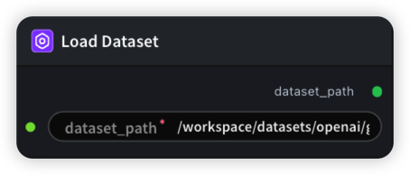

# LoadDataset Node

  

## 2.1.1 Overview

Receives a dataset path, validates its accessibility, and passes the path through.

- **Path Resolution**: Accepts a user-specified dataset path as input
- **Existence Validation**: Checks whether the dataset directory exists via a bash command, ensuring the path is valid
- **Output Passthrough**: Passes the validated dataset path to downstream nodes for use in training pipelines

## 2.1.2 Input

| Parameter    | Data Type | Required | Description                                                                                |
| ------------ | --------- | -------- | ------------------------------------------------------------------------------------------ |
| source_dir | PATH      | Yes      | Path to the dataset file or directory to load. Ensure the path points to an existing dataset directory. Default: `/workspace/datasets/openai/gsm8k` |

## 2.1.3 Output

| Parameter    | Data Type | Description                                                                                                      |
| ------------ | --------- | ---------------------------------------------------------------------------------------------------------------- |
| dataset_path | STRING    | Validated dataset path (same as input), passed to downstream nodes (e.g., RL training, Rollout, etc.). Returns `Dataset path not found` if the path does not exist. |

## 2.1.4 Workflow JSON Definition

See [`workflow/LoadDataset/LoadDataset.json`](../../workflow/LoadDataset/LoadDataset.json) for the full workflow definition.

## 2.1.5 Running the Workflow

```bash
export PYROMIND_API_KEY=<your-api-key>
python -m pyromind_sdk.test_run_workflow_cli workflow/LoadDataset/LoadDataset.json [options]
```

| Option | Default | Description |
|--------|---------|-------------|
| `--name` | `loadDatasetTest` | Task name |
| `--output` | - | Output results file |
| `--poll-interval` | 5 | Poll interval in seconds |
| `--timeout` | 600 | Max wait time in seconds |
| `--pretty` | false | Pretty-print JSON output |
| `--max-retries` | 0 | Max retries for API requests |
| `-h, --help` | - | Show help message |

```bash
python -m pyromind_sdk.test_run_workflow_cli workflow/LoadDataset/LoadDataset.json --pretty
```

Example output:

```json
{
  "task_id": "4376",
  "task_name": "loadDatasetTest",
  "status": "success",
  "nodes": [
    {
      "node_key": "#1",
      "node_id": 17777,
      "node_type": "LoadDataset",
      "label": "Load Dataset",
      "start_at": "2026-06-04 05:44:25",
      "end_at": "2026-06-04 05:44:36",
      "duration": "0:00:11",
      "input": {
        "source_dir": "/workspace"
      },
      "output": {
        "dataset_path": "/workspace"
      },
      "raw": {}
    }
  ]
}
```
