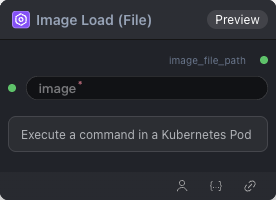

# LoadImage Node

 

## 2.2.1 Overview

Reads a selected image from `/workspace/image_cache/` and outputs its path.

Supported formats: `.jpg`, `.jpeg`, `.png`, `.gif`, `.bmp`, `.tiff`, `.webp`, `.svg`

## 2.2.2 Input

| Parameter | Data Type | Description |
|-----------|-----------|-------------|
| image     | STRING (enum) | Image file selected from the dynamic list of `/workspace/image_cache/`. Supports `image_upload` extension (allows users to upload new images). Default: first image path in the list. |

## 2.2.3 Output

| Parameter      | Data Type | Description |
|----------------|-----------|-------------|
| image_file_path | STRING    | Full path of the image in workspace, formatted as `/workspace/{selected_image_path}`. Passed to downstream nodes (e.g., RL training, Rollout) for image content reading. No path existence validation is performed. |

## 2.2.4 Workflow JSON Definition

See [`workflow/LoadImage/LoadImage.json`](../../workflow/LoadImage/LoadImage.json) for the full workflow definition.

## 2.2.5 Running the Workflow

```bash
export PYROMIND_API_KEY=<your-api-key>
pyromind run workflow/LoadImage/LoadImage.json [options]
```

| Option | Default | Description |
|--------|---------|-------------|
| `--name` | `LoadImageTest` | Task name |
| `--output` | - | Output results file |
| `--poll-interval` | 5 | Poll interval in seconds |
| `--timeout` | 600 | Max wait time in seconds |
| `--pretty` | false | Pretty-print JSON output |
| `--max-retries` | 0 | Max retries for API requests |
| `-h, --help` | - | Show help message |

```bash
pyromind run workflow/LoadImage/LoadImage.json --pretty
```

Example output:

```json
{
  "task_id": "4340",
  "task_name": "LoadImageTest",
  "status": "success",
  "nodes": [
    {
      "node_key": "#1",
      "node_id": 17729,
      "node_type": "LoadImage",
      "label": "Load Image",
      "start_at": "2026-06-04 03:48:51",
      "end_at": "2026-06-04 03:49:03",
      "duration": "0:00:12",
      "input": {
        "image": "image_cache/1.png"
      },
      "output": {
        "image_file_path": "/workspace/image_cache/1.png"
      },
      "raw": {}
    }
  ]
}
```
