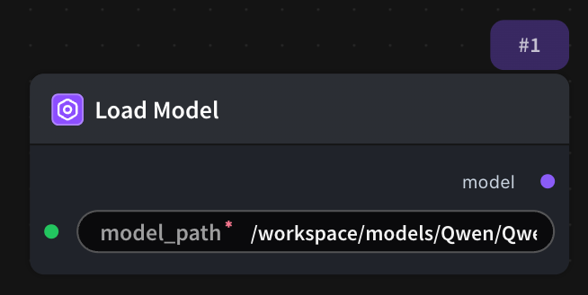

# Load Model Node



## 1.1 Overview

Loads a base model for RL training. This node loads a pretrained model from a specified path and passes the model reference to downstream nodes (such as training, inference, etc.).

## 1.2 Input

| Parameter | Data Type | Required | Description |
|-----------|-----------|----------|-------------|
| model_path | STRING | Yes | Model path pointing to the directory or file of the pretrained model. Default: `path/to/model` |

## 1.3 Output

| Parameter | Data Type | Description |
|-----------|-----------|-------------|
| model | STRING | Loaded model reference for downstream nodes |

## 1.4 Workflow JSON Definition

See [`workflow/LoadModel/LoadModel.json`](../../workflow/LoadModel/LoadModel.json) for the full workflow definition.

Example configuration:
```json
{
  "id": "c0641c5b-0f9e-4c9c-9c81-7799043e7606",
  "name": "LoadModel",
  "nodes": [
    {
      "id": "1",
      "type": "default",
      "position": {
        "x": 629.769820971867,
        "y": 565.9079283887468
      },
      "data": {
        "display_name": "Load Model",
        "nodeType": "LoadModel",
        "nodeDefinition": {
          "input": {
            "required": {
              "model_path": [
                "STRING",
                {
                  "default": "path/to/model"
                }
              ]
            }
          },
          "output": [
            "MODEL"
          ],
          "output_is_list": [
            false
          ],
          "output_name": [
            "model"
          ],
          "category": "models",
          "output_node": false,
          "experimental": false,
          "deprecated": false,
          "python_module": "test_nodes",
          "id": 146,
          "node_type": "system",
          "created_at": "2026-04-15T02:02:42.587170+00:00",
          "updated_at": "2026-04-15T02:02:42.587170+00:00",
          "version": 1,
          "description": "加载基础模型用于RL训练",
          "is_enabled": true,
          "metanode_deleted": false
        },
        "config": {
          "model_path": "/workspace/models/Qwen/Qwen3-8B/"
        },
        "definitionMissing": false,
        "disabled": false
      },
      "measured": {
        "width": 300,
        "height": 112
      },
      "properties": {},
      "style": {
        "width": 300
      }
    }
  ],
  "edges": [],
  "viewport": {
    "x": -203.38823529411764,
    "y": -96.1552941164703,
    "zoom": 0.92
  },
  "timestamp": "2026-06-09T07:49:57.491Z"
}
```

## 1.5 Running the Workflow

```bash
export PYROMIND_API_KEY=<your-api-key>
python -m pyromind_sdk.test_run_workflow_cli workflow/LoadModel/LoadModel.json [options]
```

| Option | Default | Description |
|--------|---------|-------------|
| `--name` | `LoadModel` | Task name |
| `--output` | - | Output results file |
| `--poll-interval` | 5 | Poll interval in seconds |
| `--timeout` | 600 | Max wait time in seconds |
| `--pretty` | false | Pretty-print JSON output |
| `--max-retries` | 0 | Max retries for API requests |
| `-h, --help` | - | Show help message |

```bash
python -m pyromind_sdk.test_run_workflow_cli workflow/LoadModel/LoadModel.json --pretty
```

Example output:

```json
{
  "task_id": "4907",
  "task_name": "loadmodel",
  "status": "success",
  "error_message": null,
  "nodes": [
    {
      "node_key": "#1",
      "node_id": 18959,
      "node_type": "LoadModel",
      "label": "",
      "start_at": "2026-06-09 08:25:16",
      "end_at": "2026-06-09 08:25:28",
      "duration": "0:00:12",
      "input": {
        "model_path": "/workspace/models/Qwen/Qwen3-8B/"
      },
      "output": {
        "model": "/workspace/models/Qwen/Qwen3-8B/"
      },
      "raw": {}
    }
  ]
}
```
