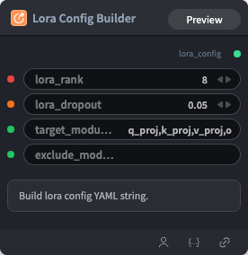

# Lora Config Builder Node



## 1.1 Overview

Builds LoRA config YAML string for optional LoRA training.

## 1.2 Input

| Parameter | Data Type | Required | Description |
|-----------|-----------|----------|-------------|
| lora_rank | INT | No | Default: `8` |
| lora_dropout | FLOAT | No | Default: `0.05` |
| target_modules | STRING | No | Default: `q_proj,k_proj,v_proj,o_proj,gate_proj,up_proj,down_proj` |
| exclude_modules | STRING | No | Default: `''` |

## 1.3 Output

| Parameter | Data Type | Description |
|-----------|-----------|-------------|
| lora_config | STRING | Built LoRA configuration YAML string |

## 1.4 Workflow JSON Definition

See [`workflow/LoraConfigBuilderNode/LoraConfigBuilderNode.json`](../../workflow/LoraConfigBuilderNode/LoraConfigBuilderNode.json) for the full workflow definition.

## 1.5 Running the Workflow

```bash
export PYROMIND_API_KEY=<your-api-key>
python -m pyromind_sdk.test_run_workflow_cli workflow/LoraConfigBuilderNode/LoraConfigBuilderNode.json [options]
```

| Option | Default | Description |
|--------|---------|-------------|
| `--name` | `loraConfigBuilderNode` | Task name |
| `--output` | - | Output results file |
| `--poll-interval` | 5 | Poll interval in seconds |
| `--timeout` | 600 | Max wait time in seconds |
| `--pretty` | false | Pretty-print JSON output |
| `--max-retries` | 0 | Max retries for API requests |
| `-h, --help` | - | Show help message |
