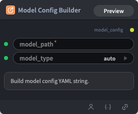

# Model Config Builder Node



## 1.1 Overview

Builds the `model_config` YAML string (model name and type). Use **Lora Config Builder** separately when LoRA fine-tuning is needed.

## 1.2 Input

| Parameter | Data Type | Required | Description |
|-----------|-----------|----------|-------------|
| model_path | STRING | No | HuggingFace model name or local path. Default: `Qwen/Qwen3-VL-2B-Instruct` |
| model_type | STRING | No | Model architecture type (`auto`, `qwen3vl`, `qwen3.5`). Options: `auto`, `qwen3vl`, `qwen3.5` |
## 1.3 Output

| Parameter | Data Type | Description |
|-----------|-----------|-------------|
| model_config | STRING\|MODEL_CONFIG | Model config YAML string |
## 1.4 Workflow JSON Definition

See [`workflow/ModelConfigBuilderNode/ModelConfigBuilderNode.json`](../../workflow/ModelConfigBuilderNode/ModelConfigBuilderNode.json) for the full workflow definition.

## 1.5 Running the Workflow

```bash
export PYROMIND_API_KEY=<your-api-key>
python -m pyromind_sdk.test_run_workflow_cli workflow/ModelConfigBuilderNode/ModelConfigBuilderNode.json [options]
```

| Option | Default | Description |
|--------|---------|-------------|
| `--name` | `modelConfigBuilderNode` | Task name |
| `--output` | - | Output results file |
| `--poll-interval` | 5 | Poll interval in seconds |
| `--timeout` | 600 | Max wait time in seconds |
| `--pretty` | false | Pretty-print JSON output |
| `--max-retries` | 0 | Max retries for API requests |
| `-h, --help` | - | Show help message |
