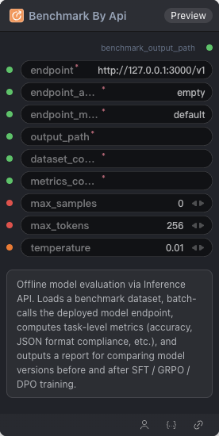

# Benchmark By API



## 1.1 Overview

Offline benchmark evaluation via an OpenAI-compatible Inference API. Loads a dataset, batch-calls the endpoint, computes metrics, and writes a report.

## 1.2 Input

| Parameter | Data Type | Required | Description |
|-----------|-----------|----------|-------------|
| endpoint | STRING | Yes | OpenAI-compatible inference API base URL |
| endpoint_api_key | STRING | Yes | Inference API key. Default: `empty` |
| endpoint_model | STRING | Yes | Model name served by the inference endpoint. Default: `default` |
| output_path | STRING | Yes | Output directory or file path |
| dataset_config | STRING\|DATASET_CONFIG | Yes | Assembled dataset configuration YAML string |
| metrics_config | STRING\|METRICS_CONFIG | Yes | Metrics config |
| max_samples | INT | No | Maximum evaluation samples (0 = all). Default: `0` |
| max_tokens | INT | No | Maximum tokens per API completion. Default: `256` |
| temperature | FLOAT | No | Sampling temperature. Default: `0.01` |
## 1.3 Output

| Parameter | Data Type | Description |
|-----------|-----------|-------------|
| benchmark_output_path | STRING | Benchmark evaluation report output path |
## 1.4 Workflow JSON Definition

See [`workflow/ModelEvalApiNode/ModelEvalApiNode.json`](../../workflow/ModelEvalApiNode/ModelEvalApiNode.json) for the full workflow definition.

## 1.5 Running the Workflow

```bash
export PYROMIND_API_KEY=<your-api-key>
python -m pyromind_sdk.test_run_workflow_cli workflow/ModelEvalApiNode/ModelEvalApiNode.json [options]
```

| Option | Default | Description |
|--------|---------|-------------|
| `--name` | `modelEvalApiNode` | Task name |
| `--output` | - | Output results file |
| `--poll-interval` | 5 | Poll interval in seconds |
| `--timeout` | 600 | Max wait time in seconds |
| `--pretty` | false | Pretty-print JSON output |
| `--max-retries` | 0 | Max retries for API requests |
| `-h, --help` | - | Show help message |
