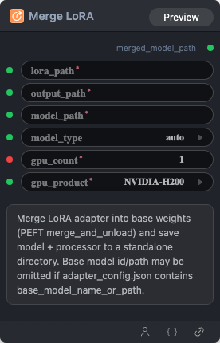

# Merge LoRA Node



## 1.1 Overview

Merge LoRA adapter into base weights (PEFT merge_and_unload) and save model + processor to a standalone directory. Base model id/path may be omitted if adapter_config.json contains base_model_path_or_path.

## 1.2 Input

| Parameter | Data Type | Required | Description |
|-----------|-----------|----------|-------------|
| lora_path | STRING | Yes | Lora path |
| output_path | STRING | Yes | Output directory or file path |
| model_path | STRING | Yes | HuggingFace model name or local path. Default: empty string |
| model_type | STRING | No | Model architecture type (`auto`, `qwen3vl`, `qwen3.5`). Default: `auto` |
| gpu_count | INT | Yes | Number of GPUs requested. Default: `1` |
| gpu_product | STRING | Yes | GPU product name (follow the GPUs actually available in the target environment). Options: `NVIDIA-H200`, `NVIDIA-H100-80GB-HBM3` |

> **Note:** GPU type and count follow the actual GPUs available in the target environment.

## 1.3 Output

| Parameter | Data Type | Description |
|-----------|-----------|-------------|
| merged_model_path | STRING | Path to merged full-weight model |

## 1.4 Workflow JSON Definition

See [`workflow/ModelMergeLoraNode/ModelMergeLoraNode.json`](../../workflow/ModelMergeLoraNode/ModelMergeLoraNode.json) for the full workflow definition.

## 1.5 Running the Workflow

```bash
export PYROMIND_API_KEY=<your-api-key>
python -m pyromind_sdk.test_run_workflow_cli workflow/ModelMergeLoraNode/ModelMergeLoraNode.json [options]
```

| Option | Default | Description |
|--------|---------|-------------|
| `--name` | `modelMergeLoraNode` | Task name |
| `--output` | - | Output results file |
| `--poll-interval` | 5 | Poll interval in seconds |
| `--timeout` | 600 | Max wait time in seconds |
| `--pretty` | false | Pretty-print JSON output |
| `--max-retries` | 0 | Max retries for API requests |
| `-h, --help` | - | Show help message |
