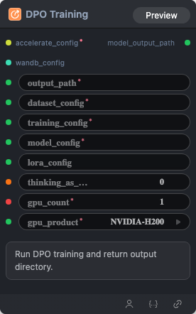

# DPO Training Node



## 1.1 Overview

Run DPO training and return output directory.

## 1.2 Input

| Parameter | Data Type | Required | Description |
|-----------|-----------|----------|-------------|
| output_path | STRING | Yes | Output directory or file path |
| dataset_config | STRING\|DATASET_CONFIG | Yes | Assembled dataset configuration YAML string |
| training_config | STRING\|TRAINING_CONFIG | Yes | Training config YAML string (`BaseTrainingConfig` fields) |
| model_config | STRING\|MODEL_CONFIG | Yes | Model config YAML string |
| lora_config | STRING\|LORA_CONFIG | No | LoRA config YAML string from Lora Config Builder |
| wandb_config | WANDB_CONFIG | No | W&B configuration object |
| thinking_as_input_ratio | FLOAT | No | Ratio of chain-of-thought content included as input. Default: `0.0` |
## 1.3 Output

| Parameter | Data Type | Description |
|-----------|-----------|-------------|
| model_output_path | STRING | Trained model output directory |
## 1.4 Workflow JSON Definition

See [`workflow/ModelTrainDPONode/ModelTrainDPONode.json`](../../workflow/ModelTrainDPONode/ModelTrainDPONode.json) for the full workflow definition.

## 1.5 Running the Workflow

```bash
export PYROMIND_API_KEY=<your-api-key>
python -m pyromind_sdk.test_run_workflow_cli workflow/ModelTrainDPONode/ModelTrainDPONode.json [options]
```

| Option | Default | Description |
|--------|---------|-------------|
| `--name` | `modelTrainDPONode` | Task name |
| `--output` | - | Output results file |
| `--poll-interval` | 5 | Poll interval in seconds |
| `--timeout` | 600 | Max wait time in seconds |
| `--pretty` | false | Pretty-print JSON output |
| `--max-retries` | 0 | Max retries for API requests |
| `-h, --help` | - | Show help message |
