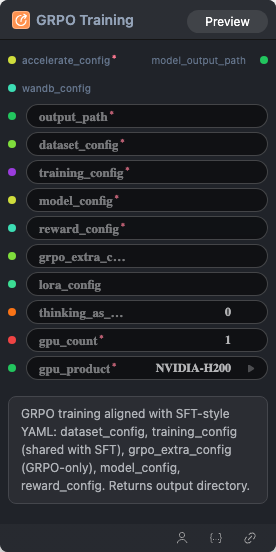

# GRPO Training Node

  

## 1.1 Overview

The main training node for GRPO, using SFT-aligned YAML configuration: includes dataset_config (dataset configuration), training_config (training configuration, shared with SFT), grpo_extra_config (GRPO-specific configuration), model_config (model configuration), and reward_config (reward configuration). This workflow returns the directory of the trained model.

## 1.2 Input

| Parameter | Data Type | Required | Description |
|-----------|-----------|----------|-------------|
| accelerate_config | STRING | Yes | YAML mapping format<br/><br/>Example:<br/> compute_environment: LOCAL_MACHINE<br/>debug: false <br/>deepspeed_config:<br/>&nbsp;&nbsp;&nbsp;&nbsp;zero3_init_flag: false<br/>&nbsp;&nbsp;&nbsp;&nbsp;zero_stage: 2<br/>distributed_type: DEEPSPEED<br/>enable_cpu_affinity: true<br/>machine_rank: 0<br/>main_training_function: main<br/>num_machines: 1<br/>num_processes: 2<br/>rdzv_backend: static<br/>same_network: true<br/>mixed_precision: bf16         |
| wandb_config | STRING | No | W&B configuration parameters, YAML mapping format<br/><br/>Example:<br/> WANDB_API_KEY: ********<br/>WANDB_PROJECT: [Your Project]<br/>WANDB_RUN_GROUP: [Your Group]                       |
| output_path | STRING | Yes | Model output path                                       |
| dataset_config | STRING | Yes | Dataset configuration, YAML mapping format  <br/><br/>Example:<br/>train_data_path: [file path]dataloader_kind: vision<br/>image_field: image_path<br/>assistant_response_field: gt<br/>messages_field: messages<br/>sft_collator_entry: [file path]:[function name] exp: /workspace/test-workflow/collator.py:build_collate_fn<br/>grpo_collator_entry: [file path]:[function name] exp: /workspace/example/collator.py:create_grpo_collate_fn<br/>max_seq_length: 4096<br/>user_prompt_field: user_prompt<br/>system_prompt_field: system_prompt<br/>val_data_path: [file path] |
| training_config | STRING | Yes | Training configuration, YAML mapping format  <br/><br/>Example:<br/>eval_steps: 100<br/>num_epochs: 0.0<br/>batch_size: 128<br/>grad_accum: 1<br/>learning_rate: 5.0e-05<br/>seed: 42<br/>max_grad_norm: 1.0<br/>lr_scheduler_type: constant<br/>                                         |
| model_config | STRING | Yes | Model configuration, YAML mapping format  <br/><br/>Example:<br/>    model_name: [model path]<br/>model_type: auto<br/>lora_rank: 8<br/>full_finetune: false<br/>                                     |
| reward_config | STRING | Yes | Reward configuration, YAML mapping format  <br/><br/>Example:<br/>normalize: false<br/>items:<br/>- entry: [file path]:[function name] exp: /workspace/example/reward.py:reward_json_parse<br/>&nbsp;&nbsp;&nbsp;&nbsp;source: python_path<br/>&nbsp;&nbsp;&nbsp;&nbsp;weight: 1.0<br/>&nbsp;&nbsp;&nbsp;&nbsp;factory: false<br/>&nbsp;&nbsp;&nbsp;&nbsp;kwargs: {}<br/>&nbsp;&nbsp;&nbsp;&nbsp;name: reward_json_parse<br/>- entry: [file path]:[function name] exp: /workspace/example/reward.py:reward_thinking_tags<br/>&nbsp;&nbsp;&nbsp;&nbsp;source: python_path<br/>&nbsp;&nbsp;&nbsp;&nbsp;weight: 1.0<br/>&nbsp;&nbsp;&nbsp;&nbsp;factory: false<br/>&nbsp;&nbsp;&nbsp;&nbsp;kwargs: {}<br/>&nbsp;&nbsp;&nbsp;&nbsp;name: reward_thinking_tags<br/>- entry: [file path]:[function name] exp: /workspace/example/reward.py:reward_task<br/>&nbsp;&nbsp;&nbsp;&nbsp;source: python_path<br/>&nbsp;&nbsp;&nbsp;&nbsp;weight: 1.0<br/>&nbsp;&nbsp;&nbsp;&nbsp;factory: false<br/>&nbsp;&nbsp;&nbsp;&nbsp;kwargs: {}<br/>&nbsp;&nbsp;&nbsp;&nbsp;name: reward_task<br/>- entry: [file path]:[function name] exp: /workspace/example/reward.py:make_reward_length<br/>&nbsp;&nbsp;&nbsp;&nbsp;source: python_path<br/>&nbsp;&nbsp;&nbsp;&nbsp;weight: 1.0<br/>&nbsp;&nbsp;&nbsp;&nbsp;factory: true<br/>&nbsp;&nbsp;&nbsp;&nbsp;kwargs:<br/>&nbsp;&nbsp;&nbsp;&nbsp;&nbsp;&nbsp;&nbsp;&nbsp;max_completion_length: 2048<br/>&nbsp;&nbsp;&nbsp;&nbsp;name: make_reward_length<br/>                                         |
| gpu_count | INT | Yes | Number of GPUs. Default: `1`                        |
| gpu_product | STRING | Yes | GPU type. Default: `NVIDIA-H100-NVL` Options: NVIDIA-H100-NVL, NVIDIA-L40S, NVIDIA-H200, NVIDIA-B200, NVIDIA-H100-80GB-HBM3                                        |
| grpo_extra_config | STRING | No | GRPO-specific configuration, YAML mapping format  <br/><br/>Example:<br/>max_steps: 500<br/>num_generations: 8<br/>max_prompt_length: 2048<br/>max_completion_length: 300<br/>temperature: 0.8<br/>enable_chord: true<br/>enable_hint: false<br/>                                     |
| thinking_as_input_ratio | FLOAT | No | Include chain-of-thought content as part of the input at the specified ratio. Default: `0.0`      |


## 1.3 Output

| Parameter | Data Type | Description |
|-----------|-----------|-------------|
| model_output_path | STRING | Model output path |

## 1.4 Workflow JSON Definition

See  [`workflow/ModelTrainGRPONode/ModelTrainGRPONode.json`](../../workflow/ModelTrainGRPONode/ModelTrainGRPONode.json) for the full workflow definition.

## 1.5 Running the Workflow

```bash
export PYROMIND_API_KEY=<your-api-key>
python -m pyromind_sdk.test_run_workflow_cli workflow/ModelTrainGRPONode/ModelTrainGRPONode.json [options]
```

| Option | Default | Description |
|--------|---------|-------------|
| `--name` | `modelTrainGRPONode` | Task name |
| `--output` | - | Output results file |
| `--poll-interval` | 5 | Poll interval in seconds |
| `--timeout` | 600 | Max wait time in seconds |
| `--pretty` | false | Pretty-print JSON output |
| `--max-retries` | 0 | Max retries for API requests |
| `-h, --help` | - | Show help message |
