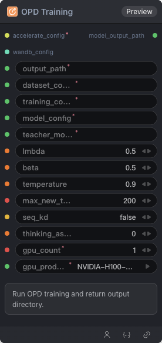

# OPD Training Node



## 1.1 Overview

Run OPD (On-Policy Distillation) training with student/teacher model configs and return output directory.

## 1.2 Input

| Parameter | Data Type | Required | Description |
|-----------|-----------|----------|-------------|
| output_path | STRING | Yes | Output directory path |
| dataset_config | STRING | Yes | Dataset configuration YAML string |
| training_config | STRING | Yes | Training configuration YAML string |
| model_config | STRING | Yes | Model configuration YAML string |
| teacher_model_config | STRING | Yes | Teacher model configuration YAML (OPD) |
| lmbda | FLOAT | No | OPD lambda hyperparameter. Default: `0.5` |
| beta | FLOAT | No | OPD beta hyperparameter. Default: `0.5` |
| temperature | FLOAT | No | Sampling temperature. Default: `0.9` |
| max_new_tokens | INT | No | Maximum new tokens to generate. Default: `200` |
| seq_kd | BOOLEAN | No | Enable sequence-level knowledge distillation. Default: `false` |
| thinking_as_input_ratio | FLOAT | No | Include chain-of-thought content as input at the given ratio. Default: `0.0` |
| wandb_config | WANDB_CONFIG | No | W&B configuration |

## 1.3 Output

| Parameter | Data Type | Description |
|-----------|-----------|-------------|
| model_output_path | STRING | Trained model output directory path |

## 1.4 Workflow JSON Definition

See [`workflow/ModelTrainOPDNode/ModelTrainOPDNode.json`](../../workflow/ModelTrainOPDNode/ModelTrainOPDNode.json) for the full workflow definition.

## 1.5 Running the Workflow

```bash
export PYROMIND_API_KEY=<your-api-key>
python -m pyromind_sdk.test_run_workflow_cli workflow/ModelTrainOPDNode/ModelTrainOPDNode.json [options]
```

| Option | Default | Description |
|--------|---------|-------------|
| `--name` | `modelTrainOPDNode` | Task name |
| `--output` | - | Output results file |
| `--poll-interval` | 5 | Poll interval in seconds |
| `--timeout` | 600 | Max wait time in seconds |
| `--pretty` | false | Pretty-print JSON output |
| `--max-retries` | 0 | Max retries for API requests |
| `-h, --help` | - | Show help message |
