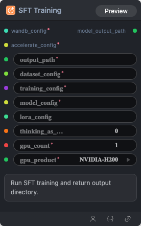

# SFT Training Node

  

## 1.1 Overview

Run SFT training and return output directory.

## 1.2 Input

| Parameter | Data Type | Required | Description |
|-----------|-----------|----------|-------------|
| output_path | STRING | Yes | String value. Default: - |
| dataset_config | STRING | Yes | String value. Default: - |
| training_config | STRING | Yes | String value. Default: - |
| model_config | STRING | Yes | String value. Default: - |
| accelerate_config | ACCELERATE_CONFIG | Yes | Accelerate configuration YAML. Default: - |
| gpu_count | INT | Yes | Integer value. Default: `1` |
| gpu_product | STRING | Yes | String value. Default: `NVIDIA-H100-NVL` Options: NVIDIA-H100-NVL, NVIDIA-L40S, NVIDIA-H200, NVIDIA-B200, NVIDIA-H100-80GB-HBM3 |
| thinking_as_input_ratio | FLOAT | No | Floating point number. Default: `0.0` |
| wandb_config | WANDB_CONFIG | No | W&B configuration YAML. Default: - |
## 1.3 Output

| Parameter | Data Type | Description |
|-----------|-----------|-------------|
| model_output_path | STRING | String value |

## 1.4 Workflow JSON Definition

See [`workflow/ModelTrainSFTNode/ModelTrainSFTNode.json`](../../workflow/ModelTrainSFTNode/ModelTrainSFTNode.json) for the full workflow definition.

## 1.5 Running the Workflow

```bash
export PYROMIND_API_KEY=<your-api-key>
python -m pyromind_sdk.test_run_workflow_cli workflow/ModelTrainSFTNode/ModelTrainSFTNode.json [options]
```

| Option | Default | Description |
|--------|---------|-------------|
| `--name` | `modelTrainSFTNode` | Task name |
| `--output` | - | Output results file |
| `--poll-interval` | 5 | Poll interval in seconds |
| `--timeout` | 600 | Max wait time in seconds |
| `--pretty` | false | Pretty-print JSON output |
| `--max-retries` | 0 | Max retries for API requests |
| `-h, --help` | - | Show help message |
