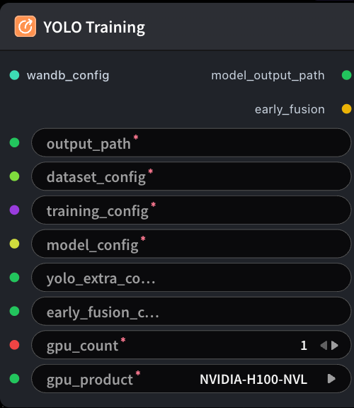

# YOLO Training



## 1.1 Overview

Runs YOLO detection / segment / classify training with the same shared `dataset_config`, `training_config`, and `model_config` pattern as SFT/GRPO. YOLO-only knobs come from **YOLO Training Extra Config Builder**; wire **Early Fusion Config Builder** for multi-view (3N→3) fusion, or leave it disconnected for native 3-channel single-view training. `dataset_config.train_data_path` should point at a `train.jsonl` (optional `val_data_path`); weights come from `model_config.model_path`.

## 1.2 Input

| Parameter | Data Type | Required | Description |
|-----------|-----------|----------|-------------|
| dataset_config | STRING\|DATASET_CONFIG | Yes | Assembled dataset configuration YAML string |
| training_config | STRING\|TRAINING_CONFIG | Yes | Training config YAML string (`BaseTrainingConfig` fields) |
| model_config | STRING\|MODEL_CONFIG | Yes | Model config YAML string |
| gpu_count | INT | Yes | Number of GPUs to request (1–8). Default: `1` |
| gpu_product | STRING | Yes | GPU product. Options in this definition: `NVIDIA-H100-NVL`, `NVIDIA-L40S`. Default: `NVIDIA-H100-NVL` |
| yolo_extra_config | STRING | No | YOLO-only extra training config YAML. Default: empty string |
| wandb_config | WANDB_CONFIG | No | W&B configuration object. Default: empty string |
| early_fusion_config | STRING | No | Early-fusion config YAML. Default: empty string |

## 1.3 Output

| Parameter | Data Type | Description |
|-----------|-----------|-------------|
| early_fusion | BOOLEAN | Whether early fusion was enabled for this training run |

## 1.4 Workflow JSON Definition

See [`workflow/ModelTrainYoloNode/ModelTrainYoloNode.json`](../../workflow/ModelTrainYoloNode/ModelTrainYoloNode.json) for the full workflow definition.

Before submitting the workflow, set `dataset_config`, `training_config`, and `model_config` to values valid in the target environment, and choose a supported `gpu_count` and `gpu_product`.

## 1.5 Running the Workflow

```bash
export PYROMIND_API_KEY=<your-api-key>
python -m pyromind_sdk.test_run_workflow_cli workflow/ModelTrainYoloNode/ModelTrainYoloNode.json [options]
```

| Option | Default | Description |
|--------|---------|-------------|
| `--name` | `modelTrainYoloNode` | Task name |
| `--output` | - | Output results file |
| `--poll-interval` | 5 | Poll interval in seconds |
| `--timeout` | 600 | Max wait time in seconds |
| `--pretty` | false | Pretty-print JSON output |
| `--max-retries` | 0 | Max retries for API requests |
| `-h, --help` | - | Show help message |
