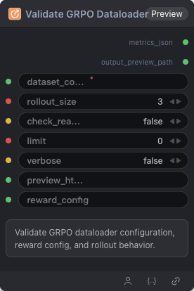

# Validate GRPO Dataloader Node



## 1.1 Overview

Validate GRPO dataloader configuration, reward config, and rollout behavior.

## 1.2 Input

| Parameter | Data Type | Required | Description |
|-----------|-----------|----------|-------------|
| dataset_config | STRING | Yes | Dataset configuration YAML string |
| rollout_size | INT | No | Default: `3` |
| check_reasoning | BOOLEAN | No | Default: `false` |
| limit | INT | No | Default: `0` |
| verbose | BOOLEAN | No | Default: `false` |
| preview_html_path | STRING | No | Default: `''` |
| reward_config | STRING | No | Reward configuration YAML string. Default: `''` |

## 1.3 Output

| Parameter | Data Type | Description |
|-----------|-----------|-------------|
| metrics_json | STRING | metrics_json |
| output_preview_path | STRING | Generated preview HTML file path |

## 1.4 Workflow JSON Definition

See [`workflow/ModelValidateGRPODataloaderNode/ModelValidateGRPODataloaderNode.json`](../../workflow/ModelValidateGRPODataloaderNode/ModelValidateGRPODataloaderNode.json) for the full workflow definition.

## 1.5 Running the Workflow

```bash
export PYROMIND_API_KEY=<your-api-key>
python -m pyromind_sdk.test_run_workflow_cli workflow/ModelValidateGRPODataloaderNode/ModelValidateGRPODataloaderNode.json [options]
```

| Option | Default | Description |
|--------|---------|-------------|
| `--name` | `modelValidateGRPODataloaderNode` | Task name |
| `--output` | - | Output results file |
| `--poll-interval` | 5 | Poll interval in seconds |
| `--timeout` | 600 | Max wait time in seconds |
| `--pretty` | false | Pretty-print JSON output |
| `--max-retries` | 0 | Max retries for API requests |
| `-h, --help` | - | Show help message |
