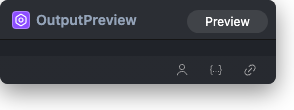

# Output Preview Node



## 1.1 Overview

System utility node reserved for workflow output preview integration. The current SDK definition does not expose configurable inputs or outputs.

## 1.2 Input

This node has no inputs.

## 1.3 Output

This node has no outputs.

## 1.4 Workflow JSON Definition

See [`workflow/OutputPreview/OutputPreview.json`](../../workflow/OutputPreview/OutputPreview.json) for the full workflow definition.

## 1.5 Running the Workflow

```bash
export PYROMIND_API_KEY=<your-api-key>
python -m pyromind_sdk.test_run_workflow_cli workflow/OutputPreview/OutputPreview.json [options]
```

| Option | Default | Description |
|--------|---------|-------------|
| `--name` | `outputPreview` | Task name |
| `--output` | - | Output results file |
| `--poll-interval` | 5 | Poll interval in seconds |
| `--timeout` | 600 | Max wait time in seconds |
| `--pretty` | false | Pretty-print JSON output |
| `--max-retries` | 0 | Max retries for API requests |
| `-h, --help` | - | Show help message |
