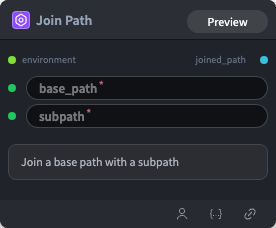

# Join Path Node

  

## 1.1 Overview

Path joining utility node: concatenates `base_path` and `subpath` into a complete path string for downstream nodes.
`base_path` and `subpath` can come from upstream node outputs or be set directly in the node configuration.
- **Typical use case**: combine a workspace root (e.g. `/workspace/`) with a relative subdirectory (e.g. `models`, `datasets/gsm8k`) to produce a full path for models, datasets, or output files.

## 1.2 Input

| Parameter | Data Type | Required | Description |
|-----------|-----------|----------|-------------|
| base_path | STRING | Yes | Base path (directory prefix). Default: `""`. Example: `/workspace/` |
| subpath | STRING | Yes | Subpath to append (relative path or directory name). Default: `""`. Example: `models` |
| environment | ENV | No | Optional environment variable configuration. Default: - |

## 1.3 Output

| Parameter | Data Type | Description |
|-----------|-----------|-------------|
| joined_path | PATH\|STRING | The joined full path. For example, with `base_path=/workspace/` and `subpath=models`, outputs `/workspace/models` |

## 1.4 Workflow JSON Definition

See [`workflow/PathJoinNode/PathJoinNode.json`](../../workflow/PathJoinNode/PathJoinNode.json) for the full workflow definition.

Example node configuration:

```json
{
  "base_path": "/workspace/",
  "subpath": "models",
  "environment": ""
}
```

## 1.5 Running the Workflow

```bash
export PYROMIND_API_KEY=<your-api-key>
python -m pyromind_sdk.test_run_workflow_cli workflow/PathJoinNode/PathJoinNode.json [options]
```

| Option | Default | Description |
|--------|---------|-------------|
| `--name` | `pathJoinNode` | Task name |
| `--output` | - | Output results file |
| `--poll-interval` | 5 | Poll interval in seconds |
| `--timeout` | 600 | Max wait time in seconds |
| `--pretty` | false | Pretty-print JSON output |
| `--max-retries` | 0 | Max retries for API requests |
| `-h, --help` | - | Show help message |

```bash
python -m pyromind_sdk.test_run_workflow_cli workflow/PathJoinNode/PathJoinNode.json --pretty
```

Example output:

```json
{
  "task_name": "unsaved-workflow",
  "status": "success",
  "nodes": [
    {
      "node_key": "#2",
      "node_id": 18563,
      "node_type": "PathJoinNode",
      "label": "Join Path",
      "start_at": "2026-06-08 03:21:17",
      "end_at": "2026-06-08 03:21:27",
      "duration": "0:00:10",
      "input": {
        "base_path": "/workspace/",
        "subpath": "models",
        "environment": ""
      },
      "output": {
        "joined_path": "/workspace/models"
      },
      "raw": {}
    }
  ]
}
```
