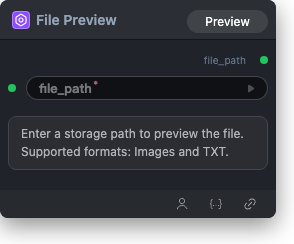

# File Preview Node



## 1.1 Overview

Enter a storage path to preview a file. Supported formats include images and TXT files.

## 1.2 Input

| Parameter | Data Type | Required | Description |
|-----------|-----------|----------|-------------|
| file_path | STRING | Yes | Storage path of the file to preview |

## 1.3 Output

| Parameter | Data Type | Description |
|-----------|-----------|-------------|
| file_path | STRING | Storage path of the previewed file |

## 1.4 Workflow JSON Definition

See [`workflow/PreviewFile/PreviewFile.json`](../../workflow/PreviewFile/PreviewFile.json) for the full workflow definition.

## 1.5 Running the Workflow

```bash
export PYROMIND_API_KEY=<your-api-key>
python -m pyromind_sdk.test_run_workflow_cli workflow/PreviewFile/PreviewFile.json [options]
```

| Option | Default | Description |
|--------|---------|-------------|
| `--name` | `previewFile` | Task name |
| `--output` | - | Output results file |
| `--poll-interval` | 5 | Poll interval in seconds |
| `--timeout` | 600 | Max wait time in seconds |
| `--pretty` | false | Pretty-print JSON output |
| `--max-retries` | 0 | Max retries for API requests |
| `-h, --help` | - | Show help message |
