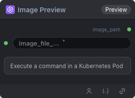

# Image Preview Node

  

## 1.1 Overview


> **TODO**: Add overview description


## 1.2 Input

| Parameter | Data Type | Required | Description |
|-----------|-----------|----------|-------------|
| image_file_path | STRING | Yes | String value. Default: - |
## 1.3 Output

| Parameter | Data Type | Description |
|-----------|-----------|-------------|
| image_path | STRING | String value |

## 1.4 Workflow JSON Definition

See [`workflow/PreviewImageEx/PreviewImageEx.json`](../../workflow/PreviewImageEx/PreviewImageEx.json) for the full workflow definition.

## 1.5 Running the Workflow

```bash
export PYROMIND_API_KEY=<your-api-key>
python -m pyromind_sdk.test_run_workflow_cli workflow/PreviewImageEx/PreviewImageEx.json [options]
```

| Option | Default | Description |
|--------|---------|-------------|
| `--name` | `previewImageEx` | Task name |
| `--output` | - | Output results file |
| `--poll-interval` | 5 | Poll interval in seconds |
| `--timeout` | 600 | Max wait time in seconds |
| `--pretty` | false | Pretty-print JSON output |
| `--max-retries` | 0 | Max retries for API requests |
| `-h, --help` | - | Show help message |
