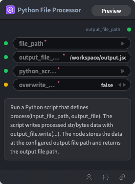

# Python File Processor Node

## 1.1 Overview

Run a Python script that defines `process(input_file_path, output_file)`. The script writes text or bytes to `output_file`; the node returns the resulting file path.

## 1.2 Input

| Parameter | Data Type | Required | Description |
|-----------|-----------|----------|-------------|
| file_path | STRING | Yes | Input file path. |
| output_file_path | STRING | Yes | Path for the generated output file. Default: /workspace/output.json |
| python_script_path | STRING | Yes | Python script path. The script must define process(input_file_path, output_file). |
| overwrite_output | BOOLEAN | Yes | Whether an existing output file may be replaced. Default: false |

## 1.3 Output

| Parameter | Data Type | Description |
|-----------|-----------|-------------|
| output_file_path | STRING | Path to the file written by the Python script. |

## 1.4 Workflow JSON Definition

See [workflow/PythonFileProcessorNode/PythonFileProcessorNode.json](../../workflow/PythonFileProcessorNode/PythonFileProcessorNode.json) for a single-node workflow example. It reads [sample_input.json](../../nodes/custom_py_script/sample_input.json) and runs [file_processor.py](../../nodes/custom_py_script/file_processor.py), which formats the JSON and writes `/workspace/output.json`.

Before running the workflow, place those two files in the execution environment at `/workspace/nodes/custom_py_script/sample_input.json` and `/workspace/nodes/custom_py_script/file_processor.py`. The workflow sets `overwrite_output` to `true`, so a repeat run may replace `/workspace/output.json`. See [custom node setup](../../nodes/README.md) for deployment details.

## 1.5 Running the Workflow

Select the target cluster and API URL as described in the [repository setup](../../README.md#setup).

~~~bash
export PYROMIND_API_KEY=<your-api-key>
python -m pyromind_sdk.test_run_workflow_cli workflow/PythonFileProcessorNode/PythonFileProcessorNode.json --pretty
~~~
