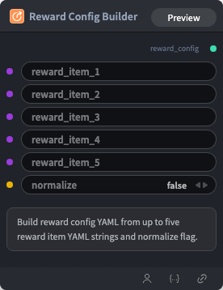

# Reward Config Builder Node

  

## {{section}} Overview

Build reward config YAML from up to five reward item YAML strings and normalize flag.

## {{section}} Input

| Parameter | Data Type | Required | Description |
|-----------|-----------|----------|-------------|
| reward_item_1 | STRING | No | String value. Default: - |
| reward_item_2 | STRING | No | String value. Default: - |
| reward_item_3 | STRING | No | String value. Default: - |
| reward_item_4 | STRING | No | String value. Default: - |
| reward_item_5 | STRING | No | String value. Default: - |
| normalize | BOOLEAN | No | Boolean flag (true/false). Default: `False` |
## {{section}} Output

| Parameter | Data Type | Description |
|-----------|-----------|-------------|
| reward_config | STRING | String value |

## {{section}} Workflow JSON Definition

See [`workflow/RewardConfigBuilderNode/RewardConfigBuilderNode.json`](../../workflow/RewardConfigBuilderNode/RewardConfigBuilderNode.json) for the full workflow definition.

## {{section}} Running the Workflow

```bash
export PYROMIND_API_KEY=<your-api-key>
python -m pyromind_sdk.test_run_workflow_cli workflow/RewardConfigBuilderNode/RewardConfigBuilderNode.json [options]
```

| Option | Default | Description |
|--------|---------|-------------|
| `--name` | `rewardConfigBuilderNode` | Task name |
| `--output` | - | Output results file |
| `--poll-interval` | 5 | Poll interval in seconds |
| `--timeout` | 600 | Max wait time in seconds |
| `--pretty` | false | Pretty-print JSON output |
| `--max-retries` | 0 | Max retries for API requests |
| `-h, --help` | - | Show help message |
