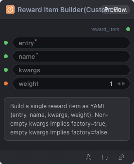

# Reward Item Builder (Custom Entry)



## 1.1 Overview

Builds a single reward item YAML from a custom Python entry path. Non-empty `kwargs` enables factory mode.

## 1.2 Input

| Parameter | Data Type | Required | Description |
|-----------|-----------|----------|-------------|
| entry | STRING | Yes | Python entry path (`module.py:function_name`) |
| name | STRING | Yes | Metric or reward item name |
| kwargs | STRING | No | YAML mapping of keyword arguments (non-empty enables factory mode). Default: empty string |
| weight | FLOAT | No | Weight multiplier in combined score. Default: `1.0` |

## 1.3 Output

| Parameter | Data Type | Description |
|-----------|-----------|-------------|
| reward_item | STRING | Single reward item YAML string |

## 1.4 Workflow JSON Definition

See [`workflow/RewardItemBuilderCustomNode/RewardItemBuilderCustomNode.json`](../../workflow/RewardItemBuilderCustomNode/RewardItemBuilderCustomNode.json) for the full workflow definition.

## 1.5 Running the Workflow

```bash
export PYROMIND_API_KEY=<your-api-key>
python -m pyromind_sdk.test_run_workflow_cli workflow/RewardItemBuilderCustomNode/RewardItemBuilderCustomNode.json [options]
```

| Option | Default | Description |
|--------|---------|-------------|
| `--name` | `rewardItemBuilderCustomNode` | Task name |
| `--output` | - | Output results file |
| `--poll-interval` | 5 | Poll interval in seconds |
| `--timeout` | 600 | Max wait time in seconds |
| `--pretty` | false | Pretty-print JSON output |
| `--max-retries` | 0 | Max retries for API requests |
| `-h, --help` | - | Show help message |
