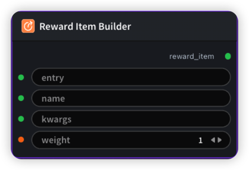

# Reward Item Builder Node

  

## {{section}} Overview

Build a single reward item as YAML (entry, name, kwargs, weight). Non-empty kwargs implies factory=true; empty kwargs implies factory=false.

## {{section}} Input

| Parameter | Data Type | Required | Description |
|-----------|-----------|----------|-------------|
| entry | STRING | No | String value. Default: - |
| name | STRING | No | String value. Default: - |
| kwargs | STRING | No | String value. Default: - |
| weight | FLOAT | No | Floating point number. Default: `1.0` |
## {{section}} Output

| Parameter | Data Type | Description |
|-----------|-----------|-------------|
| reward_item | STRING | String value |

## {{section}} Workflow JSON Definition

See [`workflow/RewardItemBuilderNode/RewardItemBuilderNode.json`](../../workflow/RewardItemBuilderNode/RewardItemBuilderNode.json) for the full workflow definition.

## {{section}} Running the Workflow

```bash
export PYROMIND_API_KEY=<your-api-key>
python -m pyromind_sdk.test_run_workflow_cli workflow/RewardItemBuilderNode/RewardItemBuilderNode.json [options]
```

| Option | Default | Description |
|--------|---------|-------------|
| `--name` | `rewardItemBuilderNode` | Task name |
| `--output` | - | Output results file |
| `--poll-interval` | 5 | Poll interval in seconds |
| `--timeout` | 600 | Max wait time in seconds |
| `--pretty` | false | Pretty-print JSON output |
| `--max-retries` | 0 | Max retries for API requests |
| `-h, --help` | - | Show help message |
