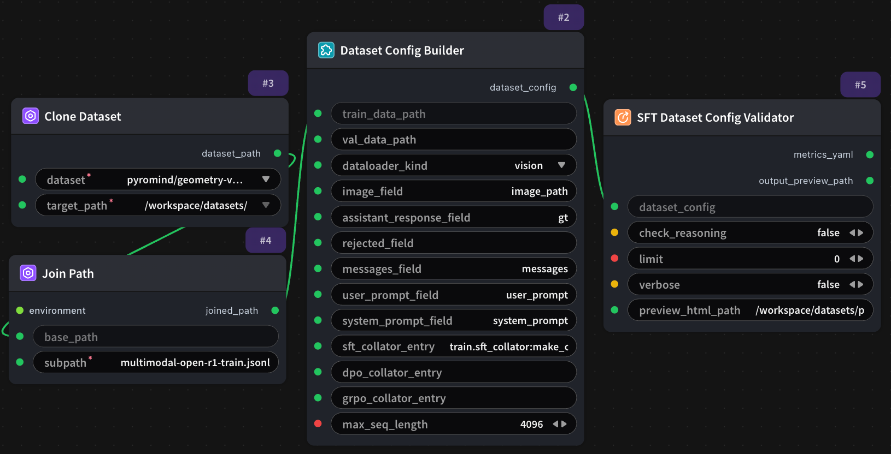

# Validate SFT Dataloader Node



## 1.1 Overview

Validates the `Dataset Config Builder` node and generates a data preview HTML file. (Requires usage alongside other nodes.)

## 1.2 Input Types

| Parameter | Data Type | Required | Description |
|-----------|-----------|----------|-------------|
| dataset_config | STRING | Yes | SFT dataset configuration path or configuration string. Supports JSON/YAML format, containing data path, format, field mapping, and other configuration information. Default: None |
| check_reasoning | BOOLEAN | No | Whether to check reasoning fields in the dataset (e.g., `reasoning`). When enabled, validates the completeness and consistency of reasoning chains. Default: `False` |
| limit | INT | No | Limits the number of data samples for validation and preview. |
| verbose | BOOLEAN | No | Whether to output detailed validation logs, including validation status, warnings, and error details for each data sample. Default: `False` |
| preview_html_path | STRING | No | Output path for the generated data preview HTML report. Supports absolute paths only. Default: `/workspace/datasets/preview.html` |

## 1.3 Output Types

| Parameter | Data Type | Description |
|-----------|-----------|-------------|
| metrics_yaml | STRING | YAML-formatted string of validation metrics. Contains detailed metrics including data quality score, format accuracy rate, field completeness, sample statistics, etc. Can be saved as a file or passed to downstream nodes. |
| output_preview_path | STRING | The full path to the actual generated preview HTML file. If the input parameter `preview_html_path` is a directory or no filename is specified, the system will automatically generate a filename and return the actual path. |

## 1.4 Workflow JSON Definition

See the complete workflow definition at [`workflow/SFTDatasetConfigValidatorNode/SFTDatasetConfigValidatorNode.json`](../../workflow/SFTDatasetConfigValidatorNode/SFTDatasetConfigValidatorNode.json).

## 1.5 Running the Workflow

```bash
export PYROMIND_API_KEY=<your-api-key>
python -m pyromind_sdk.test_run_workflow_cli workflow/SFTDatasetConfigValidatorNode/SFTDatasetConfigValidatorNode.json [options]
```

| Option | Default | Description |
|--------|---------|-------------|
| `--name` | `SFTDatasetConfigValidatorNode` | Task name |
| `--output` | - | Output result file path |
| `--poll-interval` | 5 | Polling interval (seconds) |
| `--timeout` | 600 | Maximum wait time (seconds) |
| `--pretty` | false | Pretty-print JSON output |
| `--max-retries` | 0 | Maximum number of retries for API requests |
| `-h, --help` | - | Show help information |

```bash
python -m pyromind_sdk.test_run_workflow_cli workflow/SFTDatasetConfigValidatorNode/SFTDatasetConfigValidatorNode.json --pretty
```

Example output:

```json
{
  "task_id": "5082",
  "task_name": "unsaved-workflow",
  "status": "success",
  "error_message": null,
  "nodes": [
    {
      "node_key": "#5",
      "node_id": 19548,
      "node_type": "ModelSFTDatasetConfigValidatorNode",
      "label": "SFT Dataset Config Validator",
      "start_at": "2026-06-11 08:37:27",
      "end_at": "2026-06-11 08:38:27",
      "duration": "0:01:00",
      "input": {
        "dataset_config": "",
        "check_reasoning": false,
        "limit": 0,
        "verbose": false,
        "preview_html_path": "/workspace/datasets/preview.html"
      },
      "output": {
        "metrics_yaml": "dataloader_kind: vision\ntotal_rows: 1307\nvalidated_rows: 1307\nsample_keys:\n- __data_dir__\n- gt\n- id\n- image_path\n- images\n- system_prompt\n- user_prompt\nhas_image: true\nhas_text: true\nhas_messages: false\ncollator_loaded: true\nbatch_built: true\ncollator_output_type: tuple",
        "output_preview_path": "/workspace/datasets/preview.html"
      },
      "raw": {}
    },
    {
      "node_key": "#2",
      "node_id": 19547,
      "node_type": "DatasetConfigBuilderNode",
      "label": "Dataset Config Builder",
      "start_at": "2026-06-11 08:37:01",
      "end_at": "2026-06-11 08:37:21",
      "duration": "0:00:20",
      "input": {
        "train_data_path": "",
        "val_data_path": "",
        "dataloader_kind": "vision",
        "image_field": "image_path",
        "assistant_response_field": "gt",
        "rejected_field": "",
        "messages_field": "messages",
        "user_prompt_field": "user_prompt",
        "system_prompt_field": "system_prompt",
        "sft_collator_entry": "train.sft_collator:make_collate_fn",
        "dpo_collator_entry": "",
        "grpo_collator_entry": "",
        "max_seq_length": 4096
      },
      "output": {
        "dataset_config": "train_data_path: /workspace/datasets/pyromind/geometry-vqa-vlm-demo/multimodal-open-r1-train.jsonl\ndataloader_kind: vision\nimage_field: image_path\nassistant_response_field: gt\nrejected_field: ''\nmessages_field: messages\nsft_collator_entry: train.sft_collator:make_collate_fn\ndpo_collator_entry: ''\ngrpo_collator_entry: ''\nmax_seq_length: 4096\nuser_prompt_field: user_prompt\nsystem_prompt_field: system_prompt"
      },
      "raw": {}
    },
    {
      "node_key": "#4",
      "node_id": 19546,
      "node_type": "PathJoinNode",
      "label": "Join Path",
      "start_at": "2026-06-11 08:36:31",
      "end_at": "2026-06-11 08:36:49",
      "duration": "0:00:18",
      "input": {
        "base_path": "",
        "subpath": "multimodal-open-r1-train.jsonl",
        "environment": ""
      },
      "output": {
        "joined_path": "/workspace/datasets/pyromind/geometry-vqa-vlm-demo/multimodal-open-r1-train.jsonl"
      },
      "raw": {}
    },
    {
      "node_key": "#3",
      "node_id": 19545,
      "node_type": "CloneAndCacheDataset",
      "label": "Clone Dataset",
      "start_at": "2026-06-11 08:36:05",
      "end_at": "2026-06-11 08:36:24",
      "duration": "0:00:19",
      "input": {
        "dataset": "pyromind/geometry-vqa-vlm-demo",
        "target_path": "/workspace/datasets/"
      },
      "output": {
        "dataset_path": "/workspace/datasets/pyromind/geometry-vqa-vlm-demo"
      },
      "raw": {}
    }
  ]
}
```