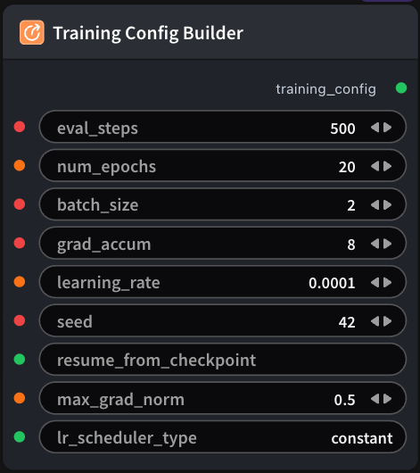

# Training Config Builder Node

  

## 1.1 Overview

Build shared training_config YAML (BaseTrainingConfig fields) for SFT and GRPO training_config inputs.

## 1.2 Input

| Parameter | Data Type | Required | Description |
|-----------|-----------|----------|-------------|
| eval_steps | INT | No | Integer value. Default: `500` |
| num_epochs | FLOAT | No | Floating point number. Default: `20` |
| batch_size | INT | No | Integer value. Default: `2` |
| grad_accum | INT | No | Integer value. Default: `8` |
| learning_rate | FLOAT | No | Floating point number. Default: `0.0001` |
| seed | INT | No | Integer value. Default: `42` |
| resume_from_checkpoint | STRING | No | String value. Default: - |
| max_grad_norm | FLOAT | No | Floating point number. Default: `0.5` |
| lr_scheduler_type | STRING | No | String value. Default: `constant` |
## 1.3 Output

| Parameter | Data Type | Description |
|-----------|-----------|-------------|
| training_config | STRING | String value |

## 1.4 Workflow JSON Definition

See [`workflow/SFTTrainingConfigBuilderNode/SFTTrainingConfigBuilderNode.json`](../../workflow/SFTTrainingConfigBuilderNode/SFTTrainingConfigBuilderNode.json) for the full workflow definition.

## 1.5 Running the Workflow

```bash
export PYROMIND_API_KEY=<your-api-key>
python -m pyromind_sdk.test_run_workflow_cli workflow/SFTTrainingConfigBuilderNode/SFTTrainingConfigBuilderNode.json [options]
```

| Option | Default | Description |
|--------|---------|-------------|
| `--name` | `sFTTrainingConfigBuilderNode` | Task name |
| `--output` | - | Output results file |
| `--poll-interval` | 5 | Poll interval in seconds |
| `--timeout` | 600 | Max wait time in seconds |
| `--pretty` | false | Pretty-print JSON output |
| `--max-retries` | 0 | Max retries for API requests |
| `-h, --help` | - | Show help message |
