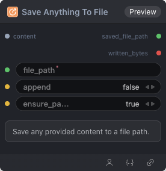

# Save Anything To File Node



## 1.1 Overview

Save any provided content to a file path.

## 1.2 Input

| Parameter | Data Type | Required | Description |
|-----------|-----------|----------|-------------|
| file_path | STRING | Yes | File path to load or save |
| content | * | No | Loaded file content. Default: empty string |
| append | BOOLEAN | No | Append. Default: false |
| ensure_parent | BOOLEAN | No | Ensure parent. Default: true |

## 1.3 Output

| Parameter | Data Type | Description |
|-----------|-----------|-------------|
| saved_file_path | STRING | Path of the saved file |
| written_bytes | INT | Number of bytes written |

## 1.4 Workflow JSON Definition

See [`workflow/SaveAnythingToFileNode/SaveAnythingToFileNode.json`](../../workflow/SaveAnythingToFileNode/SaveAnythingToFileNode.json) for the full workflow definition.

## 1.5 Running the Workflow

```bash
export PYROMIND_API_KEY=<your-api-key>
python -m pyromind_sdk.test_run_workflow_cli workflow/SaveAnythingToFileNode/SaveAnythingToFileNode.json [options]
```

| Option | Default | Description |
|--------|---------|-------------|
| `--name` | `saveAnythingToFileNode` | Task name |
| `--output` | - | Output results file |
| `--poll-interval` | 5 | Poll interval in seconds |
| `--timeout` | 600 | Max wait time in seconds |
| `--pretty` | false | Pretty-print JSON output |
| `--max-retries` | 0 | Max retries for API requests |
| `-h, --help` | - | Show help message |
