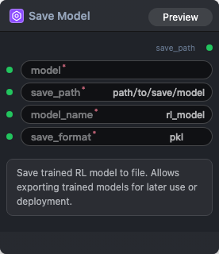

# Save Model Node

  

## {{section}} Overview

保存训练好的RL模型

## {{section}} Input

| Parameter | Data Type | Required | Description |
|-----------|-----------|----------|-------------|
| model | STRING | Yes | String value. Default: - |
| save_path | STRING | Yes | String value. Default: `path/to/save/model` |
| model_name | STRING | Yes | String value. Default: `rl_model` |
| save_format | STRING | Yes | String value. Default: `pkl` Options: pkl, onnx, torchscript, safetensors |

## {{section}} Workflow JSON Definition

See [`workflow/SaveModel/SaveModel.json`](../../workflow/SaveModel/SaveModel.json) for the full workflow definition.

## {{section}} Running the Workflow

```bash
export PYROMIND_API_KEY=<your-api-key>
python -m pyromind_sdk.test_run_workflow_cli workflow/SaveModel/SaveModel.json [options]
```

| Option | Default | Description |
|--------|---------|-------------|
| `--name` | `saveModel` | Task name |
| `--output` | - | Output results file |
| `--poll-interval` | 5 | Poll interval in seconds |
| `--timeout` | 600 | Max wait time in seconds |
| `--pretty` | false | Pretty-print JSON output |
| `--max-retries` | 0 | Max retries for API requests |
| `-h, --help` | - | Show help message |
