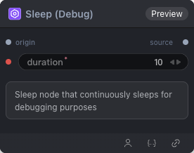

# Sleep (Debug) Node

  

## {{section}} Overview

Sleep 节点：持续睡眠用于调试

## {{section}} Input

| Parameter | Data Type | Required | Description |
|-----------|-----------|----------|-------------|
| duration | INT | Yes | Integer value. Default: `10` |
| interval | INT | Yes | Integer value. Default: `2` |
## {{section}} Output

| Parameter | Data Type | Description |
|-----------|-----------|-------------|
| status | STRING | String value |

## {{section}} Workflow JSON Definition

See [`workflow/SleepNode/SleepNode.json`](../../workflow/SleepNode/SleepNode.json) for the full workflow definition.

## {{section}} Running the Workflow

```bash
export PYROMIND_API_KEY=<your-api-key>
python -m pyromind_sdk.test_run_workflow_cli workflow/SleepNode/SleepNode.json [options]
```

| Option | Default | Description |
|--------|---------|-------------|
| `--name` | `sleepNode` | Task name |
| `--output` | - | Output results file |
| `--poll-interval` | 5 | Poll interval in seconds |
| `--timeout` | 600 | Max wait time in seconds |
| `--pretty` | false | Pretty-print JSON output |
| `--max-retries` | 0 | Max retries for API requests |
| `-h, --help` | - | Show help message |
