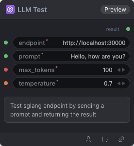

# LLM Test Node

  

## {{section}} Overview

Test Sglang Node：测试 sglang endpoint 的节点

## {{section}} Input

| Parameter | Data Type | Required | Description |
|-----------|-----------|----------|-------------|
| endpoint | STRING | Yes | String value. Default: `http://localhost:30000` |
| prompt | STRING | Yes | String value. Default: `Hello, how are you?` |
| max_tokens | INT | Yes | Integer value. Default: `100` |
| temperature | FLOAT | Yes | Floating point number. Default: `0.7` |
## {{section}} Output

| Parameter | Data Type | Description |
|-----------|-----------|-------------|
| result | STRING | String value |

## {{section}} Workflow JSON Definition

See [`workflow/TestLLMNode/TestLLMNode.json`](../../workflow/TestLLMNode/TestLLMNode.json) for the full workflow definition.

## {{section}} Running the Workflow

```bash
export PYROMIND_API_KEY=<your-api-key>
python -m pyromind_sdk.test_run_workflow_cli workflow/TestLLMNode/TestLLMNode.json [options]
```

| Option | Default | Description |
|--------|---------|-------------|
| `--name` | `testLLMNode` | Task name |
| `--output` | - | Output results file |
| `--poll-interval` | 5 | Poll interval in seconds |
| `--timeout` | 600 | Max wait time in seconds |
| `--pretty` | false | Pretty-print JSON output |
| `--max-retries` | 0 | Max retries for API requests |
| `-h, --help` | - | Show help message |
