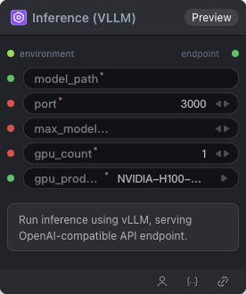

# Inference (VLLM) Node



## 1.1 Overview

Run inference using vLLM, serving an OpenAI-compatible API endpoint.

## 1.2 Input

| Parameter | Data Type | Required | Description |
|-----------|-----------|----------|-------------|
| model_path | STRING | Yes | Model path reference |
| port | INT | Yes | Inference service port number. Default: `3000` |
| gpu_count | INT | Yes | Number of GPUs used by the inference service. Default: `1` |
| gpu_product | STRING | Yes | GPU type. Default: `NVIDIA-H100-NVL` Options: NVIDIA-H100-NVL, NVIDIA-L40S, NVIDIA-H200, NVIDIA-B200, NVIDIA-H100-80GB-HBM3 |
| environment | ENV | No | Environment variables |
| max_model_len | INT | No | Maximum model context length |

## 1.3 Output

| Parameter | Data Type | Description |
|-----------|-----------|-------------|
| endpoint | STRING | Endpoint of the inference service |

## 1.4 Workflow JSON Definition

No workflow JSON definition available yet for this node.

## 1.5 Running the Workflow

```bash
export PYROMIND_API_KEY=<your-api-key>
export PYROMIND_CLUSTER=<your-cluster>
```
