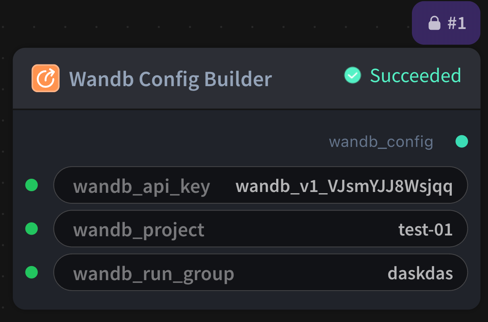

# Wandb Config Builder Node

  

## 1.1 Overview

Build wandb_config YAML string for W&B training runtime env.

## 1.2 Input

| Parameter | Data Type | Required | Description |
|-----------|-----------|----------|-------------|
| wandb_api_key | STRING | No | String value. Default: - |
| wandb_project | STRING | No | String value. Default: - |
| wandb_run_group | STRING | No | String value. Default: - |
## 1.3 Output

| Parameter | Data Type | Description |
|-----------|-----------|-------------|
| wandb_config | WANDB_CONFIG | W&B configuration YAML |

## 1.4 Workflow JSON Definition

See [`workflow/WandbConfigBuilderNode/WandbConfigBuilderNode.json`](../../workflow/WandbConfigBuilderNode/WandbConfigBuilderNode.json) for the full workflow definition.

## 1.5 Running the Workflow

```bash
export PYROMIND_API_KEY=<your-api-key>
python -m pyromind_sdk.test_run_workflow_cli workflow/WandbConfigBuilderNode/WandbConfigBuilderNode.json [options]
```

| Option | Default | Description |
|--------|---------|-------------|
| `--name` | `wandbConfigBuilderNode` | Task name |
| `--output` | - | Output results file |
| `--poll-interval` | 5 | Poll interval in seconds |
| `--timeout` | 600 | Max wait time in seconds |
| `--pretty` | false | Pretty-print JSON output |
| `--max-retries` | 0 | Max retries for API requests |
| `-h, --help` | - | Show help message |
