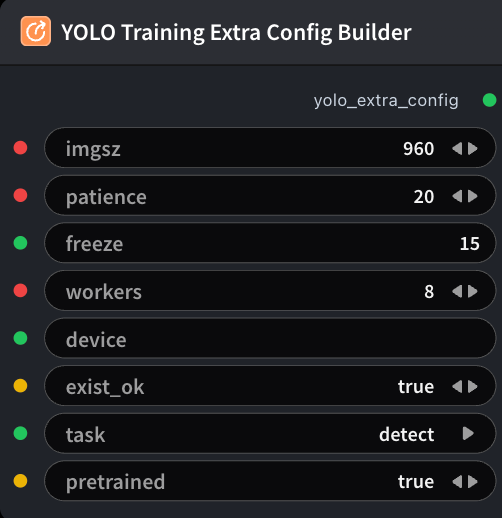

# YOLO Training Extra Config Builder



## 1.1 Overview

Builds `yolo_extra_config` YAML (imgsz, patience, freeze, task, …) for **YOLO Training** — same role as GRPO Training Extra Config. Does not set weights; wire Download/Clone Model → Model Config Builder → `ModelTrainYoloNode.model_config`.

## 1.2 Input

| Parameter | Data Type | Required | Description |
|-----------|-----------|----------|-------------|
| imgsz | INT | No | Training / inference image size. Default: `960` |
| patience | INT | No | Early-stop patience in epochs (0 disables). Default: `20` |
| freeze | STRING | No | Freeze first N backbone layers (string int or comma-separated indices). Default: `15` |
| workers | INT | No | DataLoader worker processes. Default: `8` |
| exist_ok | BOOLEAN | No | Allow reusing an existing training run directory. Default: true |
| task | STRING | No | YOLO task. Options: `detect`, `segment`, `classify` |
| pretrained | BOOLEAN | No | Initialize from pretrained weights at `model_config.model_path`. Default: true |

## 1.3 Output

| Parameter | Data Type | Description |
|-----------|-----------|-------------|
| yolo_extra_config | STRING | YOLO-only extra training config YAML |

## 1.4 Workflow JSON Definition

See [`workflow/YoloTrainingExtraConfigBuilderNode/YoloTrainingExtraConfigBuilderNode.json`](../../workflow/YoloTrainingExtraConfigBuilderNode/YoloTrainingExtraConfigBuilderNode.json) for the full workflow definition.

## 1.5 Running the Workflow

```bash
export PYROMIND_API_KEY=<your-api-key>
python -m pyromind_sdk.test_run_workflow_cli workflow/YoloTrainingExtraConfigBuilderNode/YoloTrainingExtraConfigBuilderNode.json [options]
```

| Option | Default | Description |
|--------|---------|-------------|
| `--name` | `yoloTrainingExtraConfigBuilderNode` | Task name |
| `--output` | - | Output results file |
| `--poll-interval` | 5 | Poll interval in seconds |
| `--timeout` | 600 | Max wait time in seconds |
| `--pretty` | false | Pretty-print JSON output |
| `--max-retries` | 0 | Max retries for API requests |
| `-h, --help` | - | Show help message |
